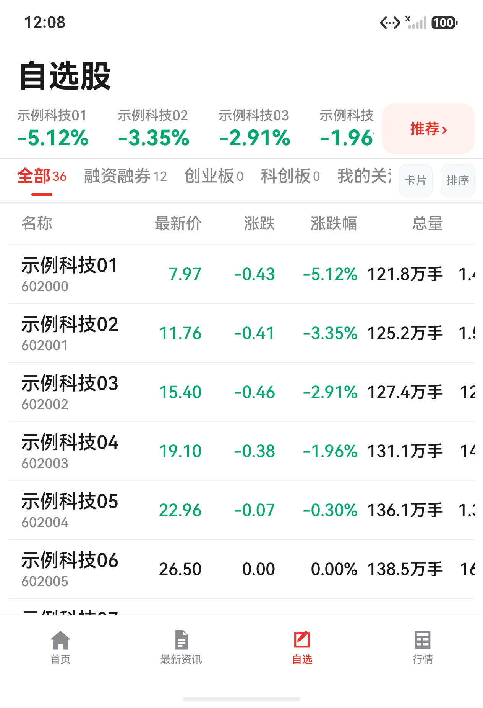
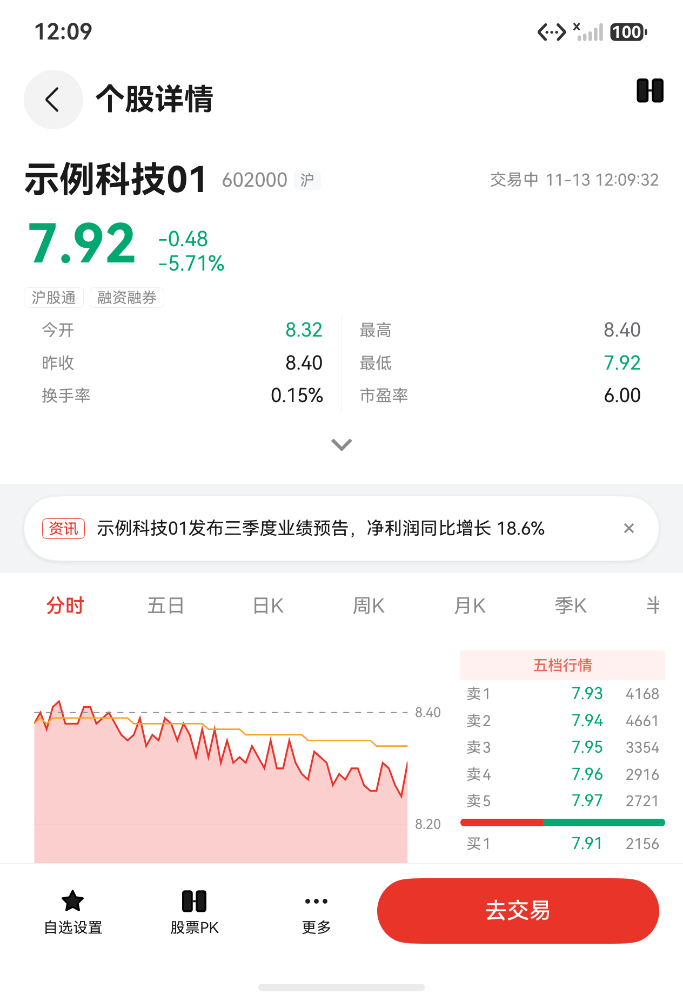
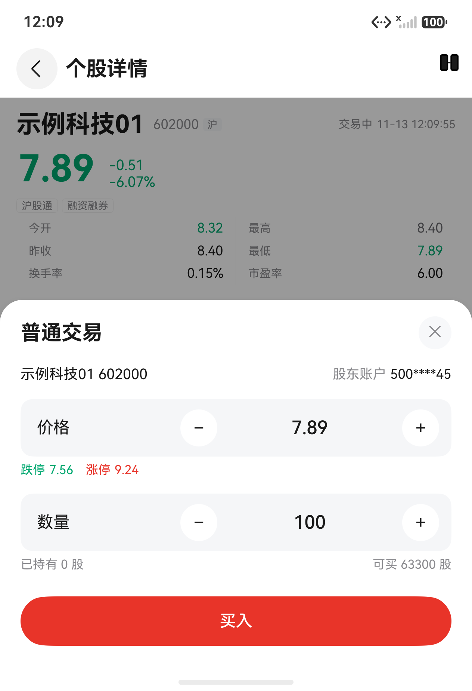
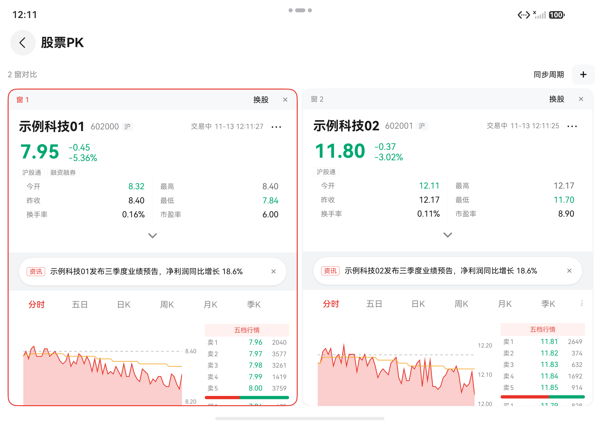
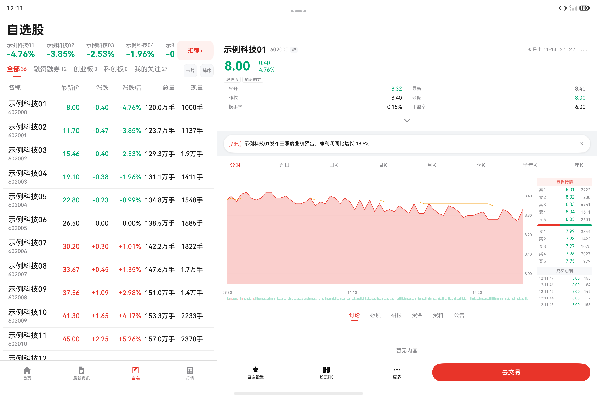

# 小杨股票 · AIStock

[](https://github.com/AndGirl/AI-hmos-Stock/actions/workflows/gate.yml)


> 面向 HarmonyOS 6.x（API 20）的个人股票行情与交易客户端演示工程：**自选列表 → 个股详情 → 买入委托 → 折叠屏/平板多窗比价**。
> 当前为**阶段一（可演示）**，版本 `1.0.0`；行情、盘口、资讯与交易**全部为 Mock 数据**，未接入真实行情源与交易通道。

> [!WARNING]
> **合规声明**：本项目仅用于技术验证与团队内部演示，**不构成任何投资建议**，不可用于实盘交易或对外提供证券服务。界面中的标的名称、代码、价格、盘口、资讯与委托回执均为**虚构的演示数据**（如「示例科技01/602000」），与任何真实证券无关。

---

## 项目简介

「小杨股票」演示了在 HarmonyOS 上实现一套完整证券行情客户端的核心链路：多列冻结行情表、三方图表库接入、沉浸式页面、应用内多窗、以及跨设备（直板 / 折叠 / 平板）响应式布局。

| 项 | 内容 |
|---|---|
| 平台 | HarmonyOS 6.x（API 20），`phone` / `tablet` 设备类型 |
| 开发语言 | ArkTS（严格模式），UI 为 ArkUI 声明式 + **V2 状态管理** |
| 架构 | `products → features → commons` 三层单向依赖，HAR 桶导出 |
| 数据 | 4 个 Provider 全 Mock（行情 / 详情 / 自选 / 交易），契约与真实同形 |
| 当前阶段 | 阶段一（M0~M5）已验收：四 Tab、自选、详情、买入、多窗、断线/字号/埋点 |
| 后续阶段 | 阶段二（搜索、添加自选、卡片视图、横屏深色、真实行情/交易）不在本文范围 |

## 功能总览

- **自选列表**：11 列固定列集 + 名称列/表头冻结 + 横向滑动；指数条与列表逐股票同序；5 个分组；列头三态排序（降序 → 升序 → 取消）；停牌 / 新股 / 退市特殊行。
- **个股详情**：报价头（含行情时间与闪烁）、12 项指标（6/9/12 随断点展开）、8 个周期 Tab（分时/五日/日K/周K/月K/季K/半年K/年K）、图表（十字光标/缩放）、五档行情 + 成交明细、资讯条、内容 Tab、通栏动作栏；支持 page / pane / window 三种形态。
- **买入委托**：登录层 → 编辑层 → 确认层单容器切换；价格/数量步进与手输；提交成功 / 失败 / 结果未知三态；遮罩、关闭按钮与系统返回统一关闭矩阵。
- **多窗比价**：1~3 窗、禁止同标的（冲突则两窗交换）、一次性同步周期、非焦点窗降频、关窗焦点移交、冷启恢复上次对比。
- **占位与暂不实现**：首页 / 最新资讯 / 行情 Tab、搜索、添加自选、卡片视图为占位页或占位文案；真实数据、开户/KYC、持仓、资讯内容、深色模式、横屏重排不在阶段一范围。

### 自选列表（折叠 460vp）



### 个股详情（折叠 460vp）



### 买入委托（折叠 460vp）



### 2 窗比价（展开 940vp）



### 平板分栏（1440vp）



> 截图为演示数据构建：仅保留「示例科技01~36」等虚构标的（正式 Mock 数据集为 50 只），价格、盘口与资讯均由 Mock 生成。

## 技术栈

| 类别 | 选型 | 说明 |
|---|---|---|
| 系统 / SDK | HarmonyOS 6.x，compile / target / compatible = **20** | 仅支持 HarmonyOS 6.x，不做 5.x 分支 |
| 语言 | ArkTS 严格模式 | 禁用 `any` / 解构，类型显式 |
| UI | ArkUI 声明式 + `Navigation` / `NavPathStack` | 单 `EntryAbility`，不使用全局 `router` |
| 状态管理 | ArkUI **V2**（`@ComponentV2` / `@ObservedV2` / `@Local` / `@Param` / `@Event`） | 不保留 V1 备选 |
| 图表 | `@ohos/mpchart 3.0.31`（分时 / K 线 / 量能） | 图表 model 只在 `commons/data/chart` 创建 |
| 构建 | DevEco Studio + hvigor + ohpm（`devecocli` 封装） | debug / release 两套构建模式 |
| 测试 | Hypium 依赖已预留 | 当前仓库**暂无自动化用例**，以验证件 + 手工走查为主 |
| 权限 | 无 | `module.json5` 未申请任何 `requestPermissions` |

## 架构设计

```
products/entry  (Entry HAP：路由 / Tab 壳 / 页面装配)
        │
        ├── features/watchlist ──► features/detail ──► features/trade
        │                                  ▲
        │                                  └────────── features/pk
        │
        └── commons/{ui, basic, data}   (设计系统 / 基础服务 / 数据与 Mock)
```

- **单向依赖**：`products → features → commons`；features 横向仅允许 `watchlist→detail`、`detail→trade`、`pk→detail`，由 `scripts/check-architecture.mjs` 的 R-01~R-09 静态拦截。
- **壳 / 内容分离**：`DetailPage` 负责路由、返回栈、沉浸式与动作栏，`DetailContent` 是唯一内容实现（page / pane / window 三形态复用）；多窗由 `PkHost` 编排，独立订阅与持久化归 `features/pk`。
- **数据装配单点**：`commons/data/DataServices.ets` 是全工程唯一允许 `new Mock*` 的位置，上层只依赖 `QuoteProvider` / `DetailProvider` / `WatchlistProvider` / `TradeProvider` 接口。
- **状态管理**：视图层 `@Local` 持有 VM，VM 按业务 key 缓存；跨页共享服务（断点、安全区、字号、连接状态）用 `AppStorageV2` 单例。
- **订阅合并**：`DetailSubscriptionRegistry` 对同 code 合并一路订阅并多播，焦点窗 1s、非焦点窗 5s 降频。

## 目录结构

```
xiaoyang-stock/
├── AppScope/                  # 应用级配置（bundle、图标、字号缩放配置）
├── products/entry/            # Entry HAP：EntryAbility、Navigation、TabShell、页面装配
├── features/
│   ├── watchlist/             # 自选：FrozenTable / IndexStrip / GroupTabs / WatchlistVM
│   ├── detail/                # 详情：DetailContent / ChartArea / OrderBookPanel / MetricPanel
│   ├── trade/                 # 交易：TradeSheet / 编辑层 / 确认层 / TradeVM
│   └── pk/                    # 多窗：PkHost / 窗卡 / 换股 / 同步 / 持久化
├── commons/
│   ├── ui/                    # 设计系统：token、StateView、GlobalBanner、BottomTabBar
│   ├── basic/                 # 断点、安全区、字号、连接状态、埋点、性能采样
│   └── data/                  # 模型、Mock Provider、行情总线、图表引擎、DataServices
├── scripts/                   # 门禁脚本（版本 / 文案 / 分层 / gate.ps1）
├── docs/                      # 技术设计、进度文档、门禁说明（README 只引用其中两项）
├── design/                    # 16 张设计稿（内部资产，不在 README 展示）
├── requirements/              # 需求基线、横切规范、FR 子需求
├── validation/                # HTML 交互验证件与用例
└── shots/                     # 各阶段验收截图
```

## 快速开始

### 环境准备

- DevEco Studio（内置 hvigor）与 **API 20 SDK**；命令行可用 `devecocli`。
- 一台 HarmonyOS 6.x 设备或模拟器（直板 / 折叠 / 平板任一）。
- 首次构建会自动执行 `ohpm install`，无需手工装依赖。

### 构建与门禁

```powershell
devecocli build                              # 全量构建（debug）
powershell -File scripts/gate.ps1            # 版本 + 文案 + 分层 + lint 四道门禁
devecocli build --build-mode release         # release 包（signed HAP 约 1.5 MB）
```

### 运行

```powershell
devecocli run --device "Pura X Max"          # 构建 + 安装 + 启动
devecocli run --skip-build --device "M1 Tablet"
```

### 深链直达详情

```powershell
hdc -t 127.0.0.1:5555 shell "aa start -U 'zixuangu://detail?code=600519'"
```

### 签名配置（必须替换）

仓库里的 `build-profile.json5` 仍是作者本机的**调试证书**绝对路径（`certpath` / `profile` / `storeFile` 位于 `C:\Users\...\.ohos\config`），无法直接在你的机器上签名：

1. 用 DevEco Studio 的 **File → Project Structure → Signing Configs** 自动生成你自己的调试证书；
2. 或把 `signingConfigs` 中的证书路径、`keyAlias` 与口令替换为你自己的；
3. **不要提交个人证书与口令**；上架前需替换为发布证书 + Profile。

## 运行与调试

- **调试面板**（仅 debug 构建，长按触发）：
  - 自选页长按「自选股」标题：帧率采样、字号 1.3/1.45×、网络四态、清空自选、模拟加载失败；
  - 详情页长按股票名：帧率采样与网络注入；
  - 交易弹窗长按「普通交易」标题：未登录 / 未开户 / 断线 / 非交易时段 / 资金不足 / 拒单 / 超时；
  - 多窗长按顶部工具栏：订阅统计、降级、恢复上次对比、布局自检。
- **日志关键字**（`hdc shell hilog`）：`PerfMeter`、`DetailPerf`、`TradeLog` / `TradePerf`、`PkLog`、`ConnLog`、`Analytics`。
- **帧率采样**：`PerfMeter` 按 1s 窗口输出 `PERF_WIN fps/p95/jank`，原始日志见 `docs/perf/`。

## 多设备适配

| 断点 | 宽度 | 自选形态 | 详情形态 |
|---|---|---|---|
| sm | < 600vp | 单列 | 全屏页 |
| md | 600 ~ 840vp | 单列 | 全屏页 |
| lg | 840 ~ 1180vp | 单列 | 全屏页 |
| xl | ≥ 1180vp | 左栏 523vp + 右栏 | 右栏 pane（≥600vp 为全量形态，含动作栏与内容 Tab） |

- **折叠屏**：展开 940vp / 折叠 460vp 均单列；2~3 窗按可用宽度降级（<360vp 紧凑版、<240vp mini 版）。
- **平板**：1440vp 进入 xl 分栏，底栏收进左列，右栏动作栏贴窗口底部。
- **字号**：跟随系统 1.0 / 1.3 / 1.45×（`fontSizeMaxScale=1.45`），只降列不截断。
- **沉浸式**：全屏布局 + `SafeAreaService` 统一避让状态栏、导航条与折叠屏中缝。

## 数据与 Mock

| Provider | 职责 | Mock 能力 |
|---|---|---|
| `QuoteProvider` | 快照、推送、盘口、分笔 | 1s 推送、增量 patch、断线 / 弱网 / 延迟注入 |
| `DetailProvider` | 详情快照、8 周期图表、订阅 | 分时 241 点、K 线、缓存回放 |
| `WatchlistProvider` | 分组、自选条目、批量快照 | 50 只样本、停牌 / 新股 / 负市盈率 |
| `TradeProvider` | 账户上下文、登录、提交、查询 | 两账户、幂等键、2.6s 超时注入、结果未知 |

- 接入真实数据时**只需替换 `DataServices` 内的 Provider 实现**（接口与上层不变）；阶段一未包含任何网络请求代码。
- 所有数值与资讯均由 Mock 生成，`clientOrderId` 幂等、涨跌停由昨收推导。

## 性能与质量

| 指标 | 实测（模拟器） |
|---|---|
| 自选列表 | 50 行滚动 60~62 fps，p95 16ms |
| 3 窗比价 | 60.8 fps（1.0×）/ 57.4 fps（1.45×），jank ≈ 2.6% |
| 内存 | 3 窗 320.3 MB → 退出后 293.7 MB，订阅 3→1，无持续增长 |
| 包体 | debug ≈ 4.3 MB / release ≈ 1.5 MB |

> 以上为模拟器 `PerfMeter` 采样（p95 / jank 由帧回调统计），**非系统 RenderService FPS**；真机建议用 SmartPerf / Profiler 复测。

质量门禁：

- `scripts/check-version.mjs`：版本一致性与 `versionCode` 规则（V-01~V-03）；
- `scripts/check-coming-soon.mjs`：5 条占位文案的格式与硬编码检查；
- `scripts/check-architecture.mjs`：三层依赖、桶导出、`new Mock*` 单点等 R-01~R-09；
- `devecocli check lint`：CodeLinter（当前 0 error / 5 warning）；
- CI：`.github/workflows/gate.yml` 仅跑不依赖 SDK 的三项静态门禁。

## 文档

- [阶段一技术设计](docs/phase1-technical-design.md)：架构、模块、路由、数据契约、适配与门禁设计。
- [一阶段进度文档](docs/一阶段进度文档.md)：当前状态、运行命令、验收证据、已知限制与已确认口径。

## 已知限制

1. **数据全 Mock**：无真实行情 / 交易网关，未申请网络权限；不可用于实盘。
2. **签名**：仓库仍是调试证书，未上架 AGC；发布前需替换发布证书与 Profile。
3. **设备覆盖**：折叠屏仅有模拟器证据（460 / 940vp），折叠真机与悬停态未回归。
4. **性能口径**：系统级 FPS 未取到，现有数字来自 `PerfMeter`。
5. **测试**：暂无 Hypium 自动化用例，验收以截图与验证件为主。
6. **语言**：仅中文资源（`base`），未提供英文 / 深色主题。

## 合规声明

- 本项目为**技术演示**，不构成证券投资咨询、交易建议或任何形式的要约。
- 所有行情、盘口、资讯、账户与委托数据均为**虚构 Mock**，与真实市场无关；请勿据此进行投资决策。
- 项目不提供开户、交易通道或资金服务；接入真实行情与交易需具备相应资质与授权。
- 使用者应自行遵守所在地法律法规及 HarmonyOS 应用市场规范。

## 作者与团队

- 作者 / 维护者：**YBJ**
- 团队：**AIStock Team**

## 许可证

本项目采用 [MIT License](LICENSE)。
