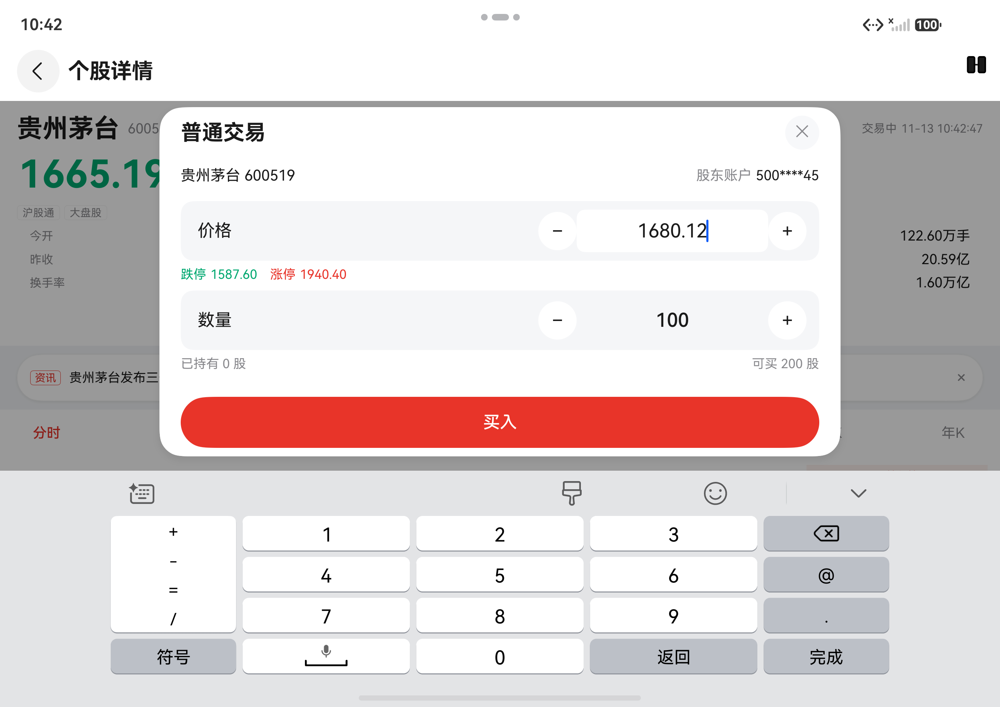
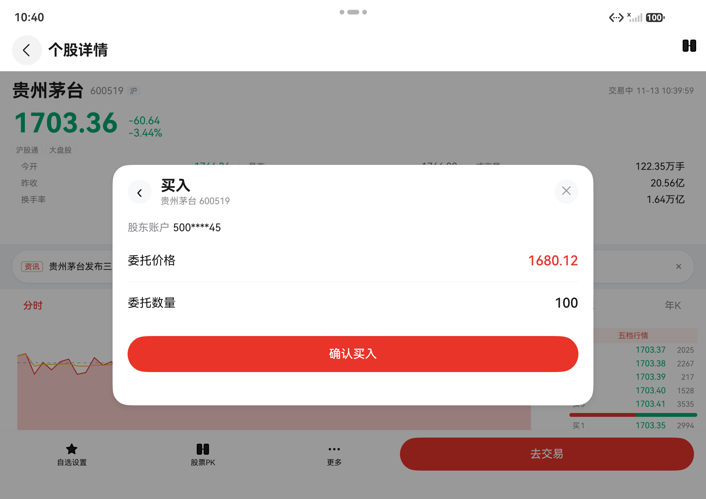
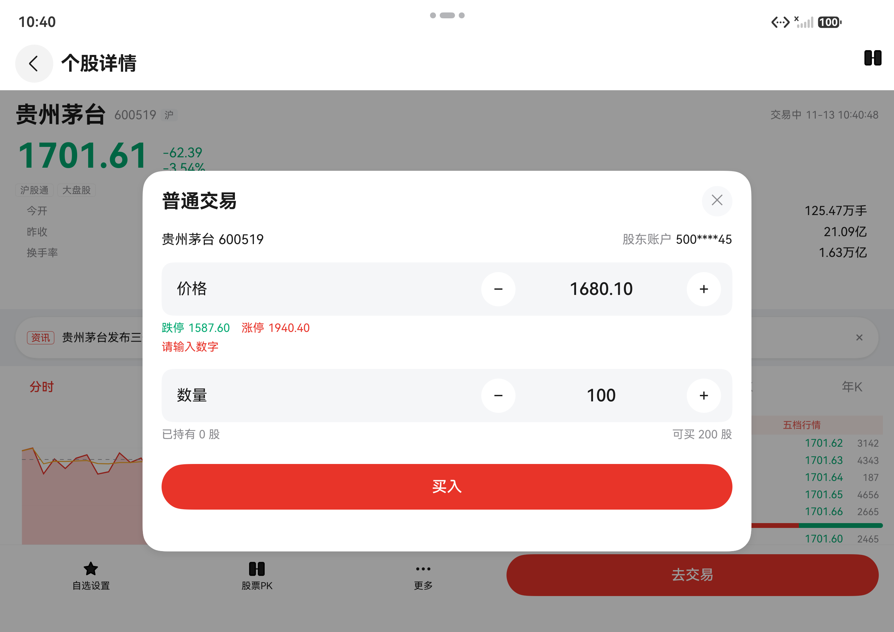
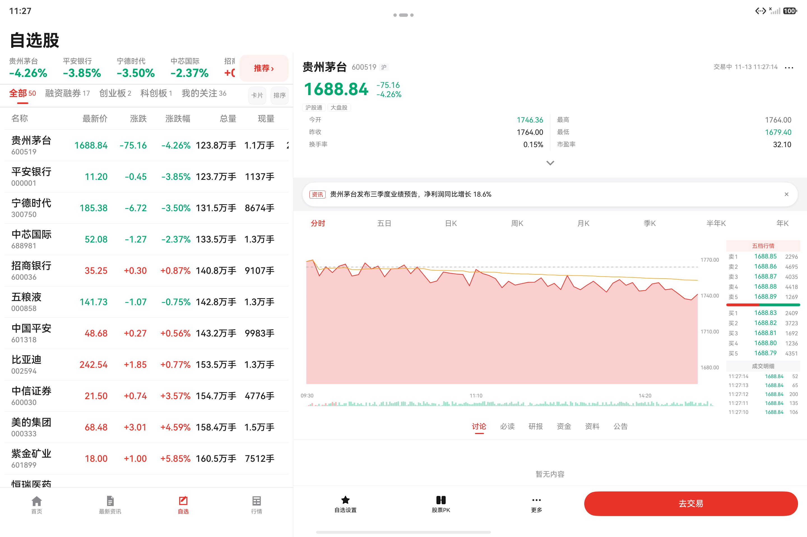
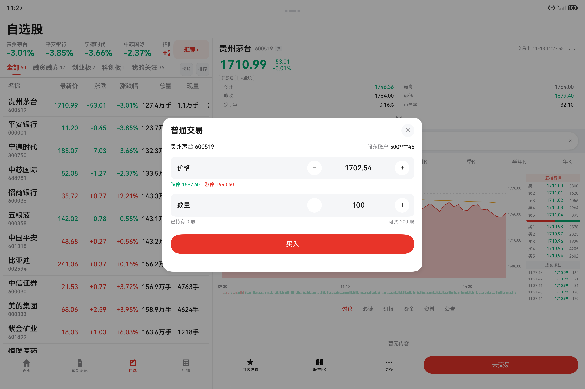

# 小杨股票 · 阶段一进度文档

> 版本：v2.3 · 更新：2026-11-13 · 状态：**阶段一验收完成**（M0~M5 全部交付；验收基线 commit `7d54c6e`）
> 用途：**新会话的唯一上下文入口**。先读本文（≈550 行），需要逐条验证、已关闭偏差或历史变更再查 [进度文档-归档.md](进度文档-归档.md)；阶段二见 [阶段二开发计划.md](阶段二开发计划.md)。
> 边界：本文只写「当前状态、怎么跑、未完成项、红线、高频坑、已确认口径」；实现细节与逐条证据在归档。

---

## 0. 新会话启动（60 秒）

1. 读完本文（约 5 分钟），不要先读设计文档全文（2160 行）。
2. 核对状态：`git log --oneline -5`、`git status --short`（应为干净）。
3. 基线可编译 + 门禁全绿：
   ```powershell
   devecocli build
   powershell -File scripts/gate.ps1   # 版本 → 文案 → 红线 → lint
   ```
4. 按 §7 文档地图只读本次任务相关章节。
5. 改动前确认范围；完成后 build + lint +（涉及 UI）模拟器截图，再提交推送。

**一句话现状**：阶段一验收完成（2026-11-13，commit `7d54c6e`）——四 Tab 外壳、11 列冻结自选表、详情三形态（page/pane/window）、买入弹窗与三态结果、2/3 窗比价（换股交换/同步周期/订阅降频/持久化恢复）、全局连接状态与断线处置、埋点出口、多窗与字号性能均已交付并有真机/模拟器证据；平板 xl 右栏已恢复通栏动作栏与内容 Tab、底栏下移左列（§10-83）。**无已知功能缺陷**，剩余仅「无设备/无网关/二期/产品未定义/发版手续」五类（§8）。

**验收结论（2026-11-13）**

| 项 | 结论 |
|---|---|
| 范围 | PRD §3.1 的 M0~M5 全部交付；AC-01~86 逐条有证据（归档 §C 154 条） |
| 门禁 | `devecocli build` ✅、`gate.ps1` GATE PASS（版本 + 文案 + R-01~R-09 + lint 0 error / 5 warning） |
| 设备 | Mate 60 Pro 388vp 真机 / Pura X Max 460·940vp / M1 Tablet 1440vp xl，三形态回归通过 |
| 遗留 | 19 项（§8），全部属环境阻塞 / 二期范围 / 产品待定义 / 发版手续，**无功能缺陷** |
| 发版 | 清单见 [一阶段发版清单.md](一阶段发版清单.md)；当前调试证书，上架需换发布证书（§8-E1/E2） |

---

## 1. 项目定位与阶段范围

- 产品：面向个人投资者的自选行情与交易工具（自选列表 → 个股详情 → 买入委托，折叠屏多窗比价）。
- 本仓库当前代码 = **阶段一**：真实行情/交易全部 Mock，三处入口（搜索/添加自选/卡片视图）只做占位；阶段二计划已定稿（[阶段二开发计划.md](阶段二开发计划.md)）但尚未开工。
- 明确不做：真实行情、真实交易网关、开户/KYC、委托列表与持仓、资讯内容、社区、研报、深色模式、横屏重排、多账户。

| 阶段 | 内容 | 状态 |
|---|---|---|
| V0 | 技术验证（11 列冻结横滑、图表库、折叠断点、V2+Navigation） | ✅ 通过（[v0-spike-report.md](v0-spike-report.md)） |
| M0 | 外壳、路由栈、深链、沉浸式、主题 token、占位组件 | ✅ 完成 |
| M1 | 11 列冻结表、指数条、分组、排序、四形态 | ✅ 完成 |
| M2 | 详情三形态、8 周期、图表、盘口、动作栏、离线两态 | ✅ 完成（2026-11-12 补齐离线/3 实例/窄窗两列盘口） |
| M3 | 买入弹窗、校验、三态结果 | ✅ 完成（真实网关联调待环境，§8-A1） |
| M4 | 2/3 窗比价、换股、同步、降频、持久化 | ✅ 完成（系统多实例 `WindowHost` 二期，§8-B1） |
| M5 | 断线、字号、无障碍、埋点、性能、发版收尾 | ✅ 完成（折叠真机待设备，§8-A2） |
| 验收 | 阶段一验收（AC-01~86 + 四形态回归 + 构建/门禁） | ✅ 2026-11-13（commit `7d54c6e`） |
| 阶段二 | 2a：M6 搜索 / M7 添加自选 / M8 卡片 / M12 横屏深色；2b：M9 行情 / M10 交易 / M11 持仓 / M13 上架 | 🟡 计划已定稿（[阶段二开发计划.md](阶段二开发计划.md)） |

**技术基线（不可协商）**

| 项 | 取值 |
|---|---|
| SDK | `compileSdkVersion` / `targetSdkVersion` / `compatibleSdkVersion` = **20** |
| 语言 | ArkTS 严格模式（禁 `any`/`unknown`、禁解构） |
| 状态管理 | **仅 V2**：`@ComponentV2` / `@ObservedV2` / `@Local` / `@Param` / `@Event` |
| 架构 | 官方三层：`products → features → commons` 单向依赖 |
| 路由 | 单 `EntryAbility` + `Navigation` / `NavPathStack`（不用全局 `router`） |
| 构建/包管理 | DevEco Studio + hvigor + ohpm（`devecocli` 封装） |
| 数据 | 三 Provider 全 Mock，契约与真实同形 |

---

## 2. 当前状态（一页纸）

| 维度 | 现状 |
|---|---|
| 模块 | 1 Entry HAP（`entry`）+ 4 Feature HAR（`watchlist`/`detail`/`trade`/`pk`）+ 3 Common HAR（`commons_ui`/`commons_basic`/`commons_data`），依赖显式声明 |
| 构建 | debug ✅（signed HAP ≈ **4.3 MB**）；`devecocli build --build-mode release` ✅（≈ **1.5 MB**） |
| 门禁 | `gate.ps1` 四步：**版本一致性 V-01~V-03** → 文案 → R-01~R-09 → lint（0 error / 5 warning） |
| 版本 | `versionName 1.0.0` / `versionCode 1000000`；app + 8 模块一致，`check-version.mjs` 守护、`bump-version.mjs` 一键改 |
| 权限 | **未申请任何 `requestPermissions`** |
| 设备证据 | Mate 60 Pro 388vp 真机（列表/详情/交易/3 窗）；Pura X Max 折叠模拟器 460/940vp；M1 Tablet 2880×1920 @2.0 → **1440vp**（xl，左栏 523 + 右栏 ≈917） |
| 性能 | 3 窗 @1.0× **60.8fps**；3 窗 @1.45× **57.4fps**（p95 16ms、jank 2.6%）；`RenderService hitchs` >16.67ms 帧数 0 |
| 内存 | 3 窗 320.3MB → 退出 PK 301.4MB → 回列表 293.7MB（−8.3%）；订阅 3→1；无持续增长 |
| 发版 | [一阶段发版清单.md](一阶段发版清单.md) 已就位；签名仍为调试证书（§8-E1） |

---

## 3. 里程碑交付摘要

| 里程碑 | 交付物 | 例外 |
|---|---|---|
| V0 | 11 列冻结横滑、mpchart 可行性、折叠断点、V2+Navigation 全部验证通过（含 50 行帧率与 388vp 真机） | — |
| M0 | 四 Tab 外壳、底部胶囊栏、主题 token、路由表（detail/pk/notFound）、深链（冷/热启动 + 300ms 去重）、安全区/沉浸式、占位与状态视图、门禁体系 | — |
| M1 | 11 列冻结表（表头+名称列冻结、右侧渐隐）、指数条与列表逐股票 1:1、5 分组、三态排序、停牌/新股特殊行、四形态与字号、行/表头朗读、`PerfMeter` 62fps | — |
| M2 | `DetailContent` 三形态、报价头、12 项指标、8 周期图表（十字光标/缩放）、五档+明细、资讯条、内容 Tab、动作栏；离线有/无缓存两态、3 图表实例、真实窄窗两列盘口 | — |
| M3 | `TradeSheet`（底部 sheet / 640vp 居中）、登录/编辑/确认单容器、门禁与单一校验出口、步进+手输、提交三态（成功/拒绝/超时查询）、关闭矩阵、键盘上移 | 真实网关联调（§8-A1） |
| M4 | `PkHost` 窗格宿主（1/2/3 窗、中缝/叠放/指示器）、换股交换、同步周期、关窗焦点移交、第 4 窗拦截、`PkStore` 恢复、订阅合并+非焦点 5s 降频、mini 版（<240vp） | `WindowHost` 系统多实例（§8-B1） |
| M5 | `ConnectionHub` 四态+退避重连、断线冻结/置灰/唯一 banner、交易断线联动、`AnalyticsHub` 埋点出口、切窗播报、字号 1.3/1.45×、3 窗性能与内存、发版清单 | 折叠真机（§8-A2） |

> 每期的任务级明细（M0-1~M5-8、产出与验收）见归档 §B。

---

## 4. 工程地图（关键文件）

```
xiaoyang-stock/
├── AppScope/                         # 应用级配置与图标（bundle: com.example.xiaoyangstock）
│                                       # app.json5 → configuration profile（fontSizeScale: followSystem / max 1.45）
├── products/entry/                   # Entry HAP
│   └── src/main/
│       ├── module.json5              # deviceTypes / pages / abilities / skills(待补深链)
│       ├── resources/                # 产品级图标、启动图、string/color
│       └── ets/
│           ├── entryability/EntryAbility.ets
│           ├── pages/Index.ets       # AppRoot：Navigation + TabShell + pageMap
│           ├── pages/{Home,News,Market}Page.ets
│           ├── pages/{Detail,Pk,NotFound}Page.ets
│           ├── shell/{TabShell,PlaceholderPage}.ets   # 底栏 BottomTabBar 已下沉 commons_ui（§10-83）
│           ├── router/AppRoutes.ets  # 路由名与参数契约
│           ├── router/{DeepLinkParser,DeepLinkHandler,LaunchParam,NavigationGuard}.ets
│           └── di/AppServices.ets    # 全局 NavPathStack + push 方法
├── features/
│   ├── watchlist/src/main/ets/
│   │   ├── view/{WatchlistPage,FrozenTable,QuoteRow,NameCell,GroupTabs,IndexStrip}.ets
│   │   ├── viewmodel/{WatchlistVM,WatchRowVM,IndexBarDataSource}.ets
│   │   └── repository/{TableMetrics,SortRules,WatchlistRepository}.ets
│   ├── detail/src/main/ets/
│   │   ├── view/{DetailContent,QuoteHeader,MetricPanel,ChartArea,OrderBookPanel,
│   │   │         NewsBar,ContentTabs,ActionBar,DetailLabels,DetailActions}.ets
│   │   ├── viewmodel/{DetailVM,DetailExports}.ets
│   │   └── repository/{DetailRepository,DetailFormat}.ets
│   ├── trade/src/main/ets/                 # M3 买入委托
│   │   ├── view/{TradeSheet,TradeEditView,TradeConfirmView,TradeLoginView,TradeText}.ets
│   │   ├── viewmodel/TradeVM.ets           # 门禁/字段/三态/幂等/关闭矩阵
│   │   └── repository/{TradeRules,TradeRepository,TradeFormat}.ets
│   ├── pk/                                  # M4 多窗比价
│   │   ├── view/{PkHost,PkToolbar,PkWindowFrame,PkStockPicker,PkText}.ets
│   │   ├── viewmodel/PkVM.ets               # 窗集合/焦点/交换/同步/降级/埋点/恢复
│   │   └── repository/{PkLayout,PkStore,PkRepository}.ets
├── commons/
│   ├── ui/src/main/ets/              # theme/TokenRegistry、components/{StateView,ComingSoon,GlobalBanner,BottomTabBar}
│   ├── ui/src/main/resources/        # color.json / float.json / ic_*.svg（含 M2 详情三个图标）
│   ├── data/src/main/ets/           # model/{QuoteModels,DetailModels,TradeModels}、entities/WatchEntities
│   │                                # mock/{MarketSeeds,DetailSeeds,TradeSeeds,MockFaults}
│   │                                # provider/{MockQuoteProvider,MockDetailProvider,MockTradeProvider,WatchlistProvider}
│   │                                # bus/{QuoteBus,DetailSubscriptionRegistry}（M4 合并/降频）、chart/ChartEngine、DataServices
│   └── basic/src/main/ets/           # services/{BreakpointService,SafeAreaService,ConfigService,ConnectionHub,Analytics,PerfMeter}、constants/{ComingSoonText,LayoutConst}
├── docs/                             # 设计说明书 + 进度文档 + 门禁说明 + perf/（帧率日志）
├── scripts/                          # 门禁脚本（版本 / 文案 / 分层 / gate.ps1）
├── .github/workflows/gate.yml        # CI 静态门禁（文案 + R-01~R-09）
├── requirements/                     # 基线、横切规范、各 FR 子需求
├── design/                           # 16 张设计稿（直板/折叠/阔折叠/平板）
├── validation/                       # HTML 交互验证件 + 测试用例 md
└── shots/                            # V0/M0/M1 验收截图
```

关键入口：

| 想看什么 | 看哪里 |
|---|---|
| 模块与依赖 | [build-profile.json5](../build-profile.json5)、各模块 `oh-package.json5` |
| 四 Tab 壳 | [TabShell.ets](../products/entry/src/main/ets/shell/TabShell.ets)、[BottomTabBar.ets](../commons/ui/src/main/ets/components/BottomTabBar.ets) |
| 路由栈/装配 | [AppServices.ets](../products/entry/src/main/ets/di/AppServices.ets)、[Index.ets](../products/entry/src/main/ets/pages/Index.ets) |
| 路由目标页 | [AppRoutes.ets](../products/entry/src/main/ets/router/AppRoutes.ets)、[DetailPage.ets](../products/entry/src/main/ets/pages/DetailPage.ets)、[PkPage.ets](../products/entry/src/main/ets/pages/PkPage.ets)、[NotFoundPage.ets](../products/entry/src/main/ets/pages/NotFoundPage.ets) |
| 深链 | [DeepLinkParser.ets](../products/entry/src/main/ets/router/DeepLinkParser.ets)、[DeepLinkHandler.ets](../products/entry/src/main/ets/router/DeepLinkHandler.ets)、[LaunchParam.ets](../products/entry/src/main/ets/router/LaunchParam.ets)、[NavigationGuard.ets](../products/entry/src/main/ets/router/NavigationGuard.ets) |
| 主题 | [TokenRegistry.ets](../commons/ui/src/main/ets/theme/TokenRegistry.ets) |
| 断点 | [BreakpointService.ets](../commons/basic/src/main/ets/services/BreakpointService.ets) |
| 安全区 | [SafeAreaService.ets](../commons/basic/src/main/ets/services/SafeAreaService.ets)、[EntryAbility.ets](../products/entry/src/main/ets/entryability/EntryAbility.ets)、[TabShell.ets](../products/entry/src/main/ets/shell/TabShell.ets) |
| 占位文案 | [ComingSoonText.ets](../commons/basic/src/main/ets/constants/ComingSoonText.ets) |
| 门禁 | [docs/gates.md](gates.md)、[gate.ps1](../scripts/gate.ps1)、[check-architecture.mjs](../scripts/check-architecture.mjs) |

---

---

## 5. 环境与命令

| 项 | 值 |
|---|---|
| 工程根 | `D:\deepseek_harness_work\xiaoyang-stock` |
| 工具链 | DevEco Studio（内置 hvigor）+ 命令行工具；`devecocli 1.3.0-stable` |
| SDK | `D:\Huawei\HuaweiSDK\20`（API 20） |
| bundle | `com.example.xiaoyangstock` |
| 模拟器 | `Pura X Max`（widefold，`127.0.0.1:5557`）；另有实体 `HUAWEI Mate 60 Pro`，多设备时命令必须显式 `--device` |
| 构建产物 | `products/entry/build/default/outputs/default/entry-default-signed.hap` |
| 远端 | `https://github.com/AndGirl/AI-hmos-Stock.git`（main） |

```powershell
cd D:\deepseek_harness_work\xiaoyang-stock

devecocli build                 # 全量编译（含 ohpm install + hvigor sync）
devecocli build --build-mode release  # 发版包（signed HAP ≈1.5MB，debug 约 4.3MB）
powershell -File scripts/gate.ps1   # 文案 + 红线 + lint 一键门禁
node scripts/check-version.mjs      # 只跑版本一致性（V-01~V-03）
node scripts/check-coming-soon.mjs  # 只跑占位文案
node scripts/check-architecture.mjs # 只跑 R-01~R-09
devecocli run --device "Pura X Max"   # 构建 + 安装 + 启动（多设备必带 --device）
devecocli run --skip-build --device "Pura X Max"
devecocli check lint            # CodeLinter（当前 0 error / 5 warning）
devecocli ui screenshot --device "Pura X Max" --path .\shots\xxx.png
devecocli emulator fold close --target "Pura X Max"   # 折叠
devecocli emulator fold open  --target "Pura X Max"   # 展开
hdc -t 127.0.0.1:5557 shell "aa start -U 'zixuangu://detail?code=600519'"
hdc -t 127.0.0.1:5557 shell "aa force-stop com.example.xiaoyangstock"  # 测冷启动前
hdc list targets
```

**M1 调试工具（仅 debug 构建）**

```powershell
# 调试面板：长按「自选股」标题 → 字号 1.3/1.45×、帧率采样、清空自选（空态）、模拟加载失败、重置
devecocli ui longclick --device "Pura X Max" 160 196        # 展开/折叠态标题坐标见 ui layout
hdc -t 127.0.0.1:5557 shell "hilog -x | grep PerfMeter"     # 帧率窗口日志（PERF_START/PERF_WIN/PERF_STOP）
devecocli emulator create "M1 Tablet" --device-type tablet --os-version "HarmonyOS 7.0.0(26.0.0)"
devecocli emulator start "M1 Tablet"                        # 平板 2880×1920 @2.0 → 1440vp → xl
```

**M2 详情性能采样（仅 debug 构建）**

```powershell
# 1) 数据/图表耗时：冷启动详情页后按周期切换，日志带 code/period/ms
hdc -t 127.0.0.1:5557 shell "aa force-stop com.example.xiaoyangstock"
hdc -t 127.0.0.1:5557 shell "aa start -U 'zixuangu://detail?code=600519'"
hdc -t 127.0.0.1:5557 shell "hilog -x | grep DetailPerf"      # snapshot / chart / chart_frame / chart_cached

# 2) 帧率：长按详情页股票名开始/停止采样（再长按一次结束）
devecocli ui longclick --device "Pura X Max" 176 332           # 折叠态名称坐标见 ui layout
hdc -t 127.0.0.1:5557 shell "hilog -x | grep PerfMeter"        # PERF_START/PERF_WIN/PERF_STOP

# 3) 真实窄窗：940vp 三窗（每窗约 311vp）即可复现 <360vp 紧凑版（图表在上 + 五档两列）
#    340vp 容器注入方式已废弃（NARROW_PANE_TEST_VP 保持 0）
```

**M3 交易调试（仅 debug 构建）**

```powershell
# 1) 打开买入弹窗：详情页点「去交易」（折叠态按钮坐标约 960,1683）
hdc -t 127.0.0.1:5555 shell "aa start -U 'zixuangu://detail?code=600519'"
devecocli ui click --device "Pura X Max" 960 1683

# 2) 逐态注入：长按「普通交易」标题 → 未登录 / 未开户 / 断线 / 非交易时段 / 更多故障（资金/拒单/超时）/ 恢复
devecocli ui longclick --device "Pura X Max" 165 890

# 3) 日志：打开耗时、提交、超时、关闭拦截、查询
hdc -t 127.0.0.1:5555 shell "hilog -x | grep -E 'TradeLog|TradePerf'"
#    trade_open / trade_edit_begin / trade_value_change / trade_confirm_view
#    trade_submit / trade_result_success|fail|unknown / trade_close_blocked / trade_query
#    TradePerf: context ms=81~85 / submit_ok

# 4) toast 截图：1.8s 很短，用设备侧快照避免 CLI 往返（见 §7 末尾）
hdc -t 127.0.0.1:5555 shell "snapshot_display -f /data/local/tmp/t.jpeg"
hdc -t 127.0.0.1:5555 file recv /data/local/tmp/t.jpeg .\shots\m3-toast.jpeg

# 5) 平板 xl 右栏入口（§10-83）：不路由，点右栏动作栏「去交易」→ 当前窗口 640vp 居中模态
#    坐标以 ui layout 为准（1440vp 下右栏按钮约 2466,1800）；底栏在左列，切 Tab 后恢复通栏
devecocli ui click --device "M1 Tablet" 2466 1800
hdc -t 127.0.0.1:5557 shell "uinput -K -d 2 -u 2"   # 系统返回只关弹窗，不退应用
```

**M4 多窗调试（仅 debug 构建）**

```powershell
# 1) 进 PK：详情页标题栏右上 ⧉（展开态约 2523,167）/ 动作栏「股票PK」/ 自选长按某行后「比价」
hdc -t 127.0.0.1:5555 shell "aa start -U 'zixuangu://detail?code=600519'"

# 2) 日志：编排（PkLog）与订阅档位（DetailPerf）
hdc -t 127.0.0.1:5555 shell "hilog -x | grep -E 'PkLog|subs_tier|subs_acquire|subs_release'"
#    pk_entry / group_created / window_open / window_close / code_swap / period_sync
#    degrade reason=limit|memory / exit_pk / pk_restore / watch_select_*
#    pk_layout_violation 出现即为布局溢出断言失败（正常不打印）

# 3) 调试面板：长按 PK 顶部工具栏（「N 窗对比」那一行）
#    订阅统计（toast 出 subs/sinks）/ 降级：非焦点窗降频 / 降级：关闭非焦点窗 /
#    恢复上次对比 / 清空持久化 / 布局自检（toast 出每个窗 x,w,compact）
devecocli ui longclick --device "Pura X Max" 500 322

# 4) 冷启恢复复现：建 2~3 窗 → force-stop → 重新进 PK（只带 1 只，不落盘）
#    → 取消选股浮层 → 长按工具栏「恢复上次对比」，日志 pk_restore windows=N ms=..
```

**M5 连接与埋点调试（仅 debug 构建）**

```powershell
# 1) 网络四态注入：自选页长按标题 → 调试面板 → 「网络…」→ 正常 / 弱网 / 断线 / 延迟
devecocli ui longclick --device "Pura X Max" 160 196      # 折叠态标题坐标，展开态见 ui layout

# 2) 日志：状态迁移 + 退避重连 + 交易联动
hdc -t 127.0.0.1:5555 shell "hilog -x | grep -E 'ConnLog|trade_net'"
#    net_state=weak|offline|delayed|online / net_retry attempt=N delay=.. ok=..
#    net_fault=offline（调试注入）/ trade_net offline=true|false（弹窗内实时）

# 3) 断线冻结自检：断线后连拍两张，数据区应像素一致（恢复后才变化）
hdc -t 127.0.0.1:5555 shell "snapshot_display -f /data/local/tmp/a.jpeg"

# 4) 埋点：批量 flush 到 hilog（接三方 SDK 时只换 AnalyticsSink）
hdc -t 127.0.0.1:5555 shell "hilog -x | grep Analytics"
#    event=pk_entry source=icon windows=2 / event=code_swap from=0 to=1
#    event=submit code=600519 / event=result_success code=600519 / event=period_switch period=d

# 5) 字号：系统设置 → 显示和亮度 → 字体大小（标准/大/特大）+ 冷启动；3 窗实测 60.8fps(1.0×) / 57.4fps(1.45×)
devecocli ui longclick --device "Pura X Max" 150 546     # 多窗：长按窗内股票名开关帧率采样
```

**权限**：本会话文件策略为 workspace-write；`devecocli` / `git` / 设备命令需要 `danger-full-access` 提权，用户通常一次性授权。建目录/删文件若被沙箱拒绝，优先用写入工具或集中到同一条提权命令。

**依赖变更后**：先 `ohpm install --all`（或直接 build，devecocli 会自动跑），再编译；每个模块会更新自己的 `oh-package-lock.json5`。
**图表依赖**：M2 起 `commons/data/oh-package.json5` 与 `features/detail/oh-package.json5` 各声明一次 `@ohos/mpchart: 3.0.31`；升级版本要同时改两处并重跑 `ohpm install --all`（`oh_modules` 装到 `oh_modules/.ohpm/` 下，源码型 HAR，可直接读 `src/main/ets/components/**` 查 API）。

---

---

## 6. 验证摘要

| 里程碑 | 关键结论（证据见归档 §C） |
|---|---|
| V0/M0 | 11 列冻结横滑 + 深链/路由/安全区全部实测；50 行三场景 59.9~62.0fps |
| M1 | 真实组件 62.2/62.1/61.7fps（p95 16ms）；系统字号 1.0/1.3/1.45× 列宽同步（834/1084/1209vp）；平板 xl 左栏 523 + 右栏 |
| M2 | 快照 181ms、8 周期 120~208ms、首帧 29~39ms、切回缓存 0 等待；停牌/新股/404/首屏失败/图表局部失败逐态；离线有缓存回放 + 无缓存错误态 + `offline_resume` |
| M3 | 8 业务态 + 2 过程态逐态；1.3/1.45× 系统字号与平板 xl 交易 640vp；真机 388vp 交易单行；价格精度：手输 4 位小数被拒为 2 位（1680.1234→1680.12）、1 位归一为 2 位（1680.1→1680.10）、空值保留原值并提示「请输入数字」 |
| M3 平板右栏（2026-11-13） | 1440vp xl：底栏收进左列、右栏（≈917vp）通栏动作栏 + 内容 Tab 贴到窗口底部；「去交易」→ 640vp 居中模态，遮罩/×/系统返回三种关闭均回到右栏且应用不退出；切 Tab 后底栏恢复通栏；窄嵌入 / 多窗仍无交易入口 |
| M4 | 2/3 窗（454/311/165vp）、换股交换、同步周期、第 4 窗拦截、冷启恢复 `ms=2`；3 窗 1.45× 57.4fps、RSS 320.3→293.7MB |
| M5 | 断线冻结 4s 像素零差异、恢复 1s 内去灰、退避 1→30s；3 窗 60.8fps（1.0×）；读屏焦点顺序（换股 → 窗卡 → 图表） |

> 完整 154 条验证记录（含全部截图引用）见归档 §C。

价格精度修复证据（2026-11-13）：





平板右栏交易入口证据（2026-11-13）：




---

## 7. 文档地图（Token 友好读法）

| 文档 | 用途 | 建议读法 |
|---|---|---|
| [requirements/00-phase1-baseline.md](../requirements/00-phase1-baseline.md) | 阶段一范围、决策、裁决、AC 索引、验收矩阵、API 20 基线 | 全文 270 行，可整读；重点 §1/§2/§4/§8/§12 |
| [小杨股票PRD.md](../小杨股票PRD.md) | 产品口径、占位文案、页面状态矩阵、里程碑、风险 | 全文 320 行，可整读；重点 §3/§4/§5/§11 |
| [docs/phase1-technical-design.md](phase1-technical-design.md) | 技术架构与实现方案（2160 行） | **不要整读**；按 §8.1 索引检索 |
| [docs/gates.md](gates.md) | 门禁规则（文案 + R-01~R-09）、命令、CI 边界 | 改依赖/文案/分层前读 |
| [docs/一阶段发版清单.md](一阶段发版清单.md) | 阶段一发版清单：版本/构建/门禁/冒烟/设备矩阵/已知限制/回滚 | 发版前逐项打勾 |
| [docs/阶段二开发计划.md](阶段二开发计划.md) | 阶段二（2a/2b）任务、排期、门禁与发布计划（1425 行） | **不要整读**；按 §0 摘要 → 负责模块章节检索 |
| [docs/v0-spike-report.md](v0-spike-report.md) | V0 五组 spike 结论、设备环境、未完成项与关闭计划 | M1/M2 开工前读 §8 |
| [requirements/fr-common-spec.md](../requirements/fr-common-spec.md) | 横切规则 CC-1~CC-7（冲突时优先级最高） | 任务涉及全局规则时读 |
| [requirements/fr02…fr08-subreq.md](../requirements) | 各功能子需求与 AC | 只读当前模块 |
| [validation/](../validation) | HTML 交互验证件 + 测试用例 | 做 UI 对照时看 |
| [design/](../design) | 16 张设计稿（直板/折叠/阔折叠/平板） | 做视觉时按设备看对应图 |

**设计文档章节索引（按任务）**

| 任务 | 读这些节 |
|---|---|
| 分层/模块/依赖/装配 | §3.1（3.1.1~3.1.12）、§3.3、§3.4、§3.6 |
| 路由/深链 | §3.5、§5.1.1 |
| M0 外壳/安全区/token/占位/状态 | §5.1（5.1.1~5.1.5） |
| 断点 | §6.1 |
| 主题/i18n/占位校验 | §6.2、§6.3 |
| 工程红线/CI | §6.6、附录 C、§3.1.10 |
| M1 自选列表 | §5.2 全节 + 附录 A 常量 |
| M2 详情 | §5.3 全节 |
| M3 交易 | §5.4 全节 |
| M4 多窗 | §5.5 全节 |
| 数据契约/实体 | §4.1~§4.8 |
| 验收/性能 | §1.3、§7、§8 |

**检索技巧**：先 `Select-String -Path docs\phase1-technical-design.md -Pattern '^#### 5\.2'` 定界，再按 offset 读局部；不要一次读整文件。

---

## 8. 未完成项（19 项：A3 / B2 / C7 / D4 / E2 / F1）

### A. 环境阻塞（3）

| # | 项 | 出处 | 阻塞 | 建议动作 |
|---|---|---|---|---|
| A1 | 真实行情/交易网关联调 | §10-48（归档） | 无真实网关 | 契约同形 + 唯一装配点 `DataServices.*Provider()`；只换 provider 与 `MockTradeProvider.login()` |
| A2 | 折叠真机 + 悬停态回归 | 归档 §B（M5-1~M5-7） | 无折叠真机 | 设备到位补 460/940vp 折叠与悬停 |
| A3 | 真机系统级性能采样 | §10-80（归档） | 模拟器 `RenderService fps` 返回空 | 真机用 SmartPerf/Profiler 复测帧率/内存/句柄 |

### B. 二期 / 明确范围外（2）

| # | 项 | 说明 |
|---|---|---|
| B1 | `WindowHost` 系统多实例 | 本期只落应用内窗格（DEC-08-01），保留接入位 |
| B2 | 真实行情/交易/账号体系（开户 KYC、持仓、委托列表） | 阶段一明确不做 |

### C. 质量待办（7）

| # | 项 | 现状 | 建议 |
|---|---|---|---|
| C1 | 指示器语音听测 / 读屏语音端到端 | 代码级 + 焦点走查通过；`uitest` 双击不触发读屏激活 | 人工读屏会话走查「第 N 个，共 3 个」 |
| C2 | 1.45× 真机回归（可选） | 模拟器已验；真机需改用户系统字号 | 用户同意后再跑 |
| C3 | 句柄数观测 | `/proc/<pid>/fd` 权限拒绝 | hidumper / Profiler |
| C4 | 冷启自动恢复 PK | 仅「恢复上次对比」手动入口 | 依赖系统页栈/会话恢复 |
| C5 | 内存告急降级接 `onMemoryLevel` | 降级链已实现，仅调试注入 | 接系统回调自动触发 |
| C6 | 调试面板/`MockFaults` 构建期裁剪 + `PerfProbe` 统一 | 入口 DEBUG 关闭，代码仍在包内 | 按构建裁剪 |
| C7 | 460vp 详情首屏被动作栏截断（需下滑看量能） | 可滚动 | 待视觉确认是否压图表高度 |

### D. 产品待定义（4）

| # | 项 | 现状 |
|---|---|---|
| D1 | 推荐卡片内容与跳转 | 样式占位（「推荐」+ 箭头，无点击） |
| D2 | 分组 Tab 右侧「卡片」「排序」占位符 | 32vp 样式占位，无行为 |
| D3 | 搜索 / 添加自选 / 卡片视图三入口 | 仅 5 条占位文案 |
| D4 | 待确认口径 | 排序是否实时保序；pane 指标 3 列；十字光标读数形式；交易遮罩是否盖标题栏；键盘态是否要求全字段同屏 |

### E. 发版待办（2）

| # | 项 | 现状 |
|---|---|---|
| E1 | 发布证书 + Profile 替换 | 当前 `keyAlias: debugKey`；上架前必须换（只改 `signingConfigs`） |
| E2 | AGC 创建应用 / 上传 release 包 / 提审 | 未执行（需 AGC 账号授权） |

### F. 文档维护（1）

- 文档已拆分：本文 ≤520 行，历史内容在归档。新增验证/偏差按「当前有效进本文、关闭后移归档」维护（§12）。

---

## 9. 约束速查（红线）

1. **仅 V2**：`@ComponentV2` 内禁用 `@State/@Prop/@Link/@Watch`；`@Param` 只读，`@Event` 上行。
2. **单向依赖**：`products → features → commons`；features 横向只允许 `watchlist→detail→trade`、`pk→detail`。
3. **跨模块只走桶导出**：`import { X } from 'detail'`，禁止深路径（R-06）。
4. **颜色零字面量**：一律 `AppColor` / `$r('app.color.*')`；涨跌必须走 `price_up/down`。
5. **占位文案单一模板**：`{对象}下阶段开放`，5 条常量，禁止「敬请期待 / 即将上线 / Coming / ~ / !」、禁止版本号。
6. **11 列固定**，不按宽度减列；平板靠横滑（DEC-09-02）。
7. **断点阈值**：600 / 840 / 1180；`xl` 才 `isSplit`；指数条 3/5/5/3。
8. **底栏遮挡**：页面底部预留 92vp（底栏 60 + 间距 8 + 呼吸 24）；底栏距屏幕底 = `avoidArea.bottom + 8vp`。
9. **toast 1.8s**；占位入口图标不置灰。
10. **单 EntryAbility**；页面跳转走 `Navigation`，禁用全局 `router`；`new Mock*/Real*` 只允许在 `commons/data/DataServices.ets`（M1 起）。
11. **禁止页面自建轮询/重连定时器**（M5 的 `ConnectionHub` 统一）。
12. **深链** scheme `zixuangu`，示例 `zixuangu://detail?code=600519&from=deeplink`。

---

---

## 10. 口径与未决偏差

### 10.1 已确认口径（2026-11-12，勿再改）

| # | 口径 |
|---|---|
| 27 | 自选表格/列表/指数条/分组 Tab 全部隐藏滑动条（`BarState.Off`），底部留 8vp 呼吸位 |
| 41 | 指标 chevron 仅在断点有隐藏项时出现：sm/md/lg/pane 有，**xl 无**（12 项全展示） |
| 42 | 资讯条白色胶囊 + `#F2F4F6` 行；page/pane/window 三形态都展示 |
| 43 | 资讯条关闭只影响当前页面实例，新开详情页重新展示（不做会话记忆） |
| 44 | 周期 Tab 最小 56×44vp，空间富余时等距铺开、窄屏横滑 |
| 45 | 图表区与盘口列统一块高 312vp，读数条叠在图表上沿（不占高） |
| 55 | 详情入口只带 1 只时自动拉起选股浮层（DEC-08-07） |
| 56 | 换股入口为窗卡「换股」按钮，不做点标题换股（DEC-08-08） |
| 57 | PK 内无 ⧉，用返回 / 关最后一窗退出（DEC-08-09） |
| 58 | 3 窗指示器内联在工具栏左侧，仅点击切焦点（DEC-08-10） |
| 59 | ~~pane/window 不提供「去交易」入口（承 FR-07.11 / AC-75）~~ **已被 §10-83 修订**：仅窄嵌入右栏（<600vp）与多窗实例不提供 |
| 63 | 卡宽 <360vp 紧凑版、<240vp mini 版（DEC-08-11） |
| 82 | 委托价格恒两位小数：手输最多两位（第三位起**直接拒绝输入**，不做事后四舍五入），1 位小数归一为 2 位；提交前 `roundPrice` 再收口一次（数量同样取整） |
| 83 | **平板 xl 右栏（宽度 ≥600vp）按设计稿给全量动作栏与内容 Tab**：动作栏含「去交易」，弹窗为当前窗口的 640vp 居中全屏模态（遮罩 / × / 系统返回均关闭且不退应用）；**底栏下移到自选左列**（右栏动作栏贴窗口底部），窄嵌入右栏（<600vp）与多窗实例仍为紧凑版、无交易入口。实现：`DetailContent.paneFull()`；`BottomTabBar` 下沉 `commons_ui`，`TabShell` 在 xl 自选页不再铺通栏底栏，改由 `WatchlistPage` 左列渲染；`WatchlistPage` 只 `onOpenTrade` / `onSelectBottomTab` 上报（不新增横向依赖） |

### 10.2 未决 / 保留偏差

| # | 项 | 现状 / 处理 |
|---|---|---|
| 15 | 排序为「快照序」 | 推送只改行不重排；若要求实时保序需加 1s 重排并评估行跳动 |
| 23 | 推荐卡片贴列表列右缘 | xl 下贴 523 右缘而非窗口右缘；改一处 `Row` 即可切换 |
| 24 | 推荐卡片内容 | 待产品定义（运营位/推荐标的） |
| 25 | 分组 Tab 右侧占位符 | 卡片视图/排序面板接入时替换 |
| 37 | pane 指标固定 2 列 | 平板右栏已恢复动作栏与内容 Tab（§10-83），指标仍为 6 项 + chevron；设计稿 `平板-首页` 为 12 项 4 列，是否同步待产品确认 |
| 38 | 460vp 首屏图表被动作栏截断 | 可滚动；首屏完整需压图表高度（待视觉） |
| 39 | 十字光标读数为顶部一行 | 未用浮层 marker；已满足读数要求 |
| 46 | 交易弹窗遮罩不盖 Navigation 标题栏 | 需上提到 AppRoot 挂载（M4 未做）；如要求覆盖可改 |
| 51 | 键盘态需滚动看部分字段 | 主按钮已贴键盘上沿；全字段同屏需更矮表单 |
| 53 | 埋点 sink 仍为 hilog | `AnalyticsSink` 可替换，接 SDK 只换 sink |
| 61 | 内存告急降级无系统信号 | 调试面板逐级触发；接 `onMemoryLevel` 见 §8-C5 |
| 62 | 冷启不自动恢复 PK | 手动「恢复上次对比」；见 §8-C4 |
| 73 | 切窗播报失败静默 | 已发 `announceForAccessibility`；语音听测见 §8-C1 |
| 76 | 真机 388vp 窄屏缺陷（已修） | 成交明细价格换行、窗卡内容宽兜底 200vp 导致裁切；修复：按盘口列宽分列 + 下限 96vp + 超窄字号档 |
| 77 | 读屏自动化限制 | `uitest` 双击不被读屏识别为激活；焦点顺序已人工走查 |
| 78 | 读屏开启时点击只聚焦 | 自动化需先关读屏，或改用可聚焦按钮节点 |
| 81 | 发版签名 | 当前调试证书，上架需发布证书 + Profile（§8-E1） |

> 已关闭偏差（#1~#14、#16~#22、#26、#28~#36、#40、#47~#50、#52、#54、#60、#64~#72、#74、#75、#79、#80）见归档 §D。

---

## 11. 高频坑（15 条，全量 65 条见归档 §E）

1. **HAR 入口**：`oh-package.json5` 的 `main` 指向模块根 `Index.ets`，否则 `00304003 Invalid main file`。
2. **`.navDestination` 只能调一次**：多次链式会后者覆盖前者，在单一 builder 内 `if/else` 分派。
3. **`$r` 可用于类静态常量**（`ComingSoonText`/`TokenRegistry`），但仅限 `.ets` 且资源存在。
4. **`AppStorageV2.connect` 在 EntryAbility 可用**；组件用 `@Local` 持同一实例即可获得 `@Trace` 刷新。
5. **全屏 + Navigation**：全屏后 Navigation 不自动避让状态栏，需 `.padding({ top: topInset })`。
6. **名称列 `translate` 会盖住表头**：外层必须套 `Stack().clip(true)`，Stack 自身不 translate。
7. **横向 `Scroll` 内容不足会居中**：需要「始终居左」时用 `listDirection(Axis.Horizontal)` 的 `List`。
8. **横向 List 跨窗口保留像素偏移**：数据/布局变化时 `scrollToIndex(0)` 复位，别指望 `onDataReloaded()`。
9. **`ForEach` 同 key 复用旧实例**：数组换新实例会让旧节点继续读旧对象；VM 必须按业务 key 复用实例再改 `@Trace`。
10. **`@Monitor` 嵌套路径**：`@Monitor('row.quote.flashSeq')` 前提是中间对象都 `@ObservedV2` + `@Trace`。
11. **mpchart 组件与 model 成对**：`LineChart({ model })` / `CandleStickChart({ model })` / `BarChart({ model })`；model 只在 `commons/data/chart` 创建。
12. **`@Local` 持有 VM 不要在 `aboutToAppear` 重新 `new`**：视图可能仍观察旧实例（表现为永远停在骨架）；用 `vm.attach()`。
13. **组件事件名避开内建属性**：`onFocus` 等已被 ArkUI 占用，自定义事件用 `onSelect/onActivate`。
14. **`AppDim.*` 是 Resource 不是 number**：尺寸算术用本地 number 常量。
15. **`Text()` 不接受 `Resource | string` 的三元**：改 `if/else` 两个 `Text`，或两个 Resource 的三元。

---

## 12. 协作约定

- 每完成一个可验收步骤：`devecocli build` + `powershell -File scripts/gate.ps1` +（UI）截图 → 中文提交（`feat/fix/docs/chore`）→ 推送 `origin/main`。
- 需求/设计口径变更：先与产品确认，再改文档，再改代码（PRD §13）。
- **文档维护规则**：
  - 本文只保留「当前有效」内容，目标 **≤560 行**；
  - 关闭的偏差、历史验证、旧变更记录移入 [归档](进度文档-归档.md)，并在对应章节留一行索引；
  - 每次里程碑或重大结构变更后更新本文版本号与 §13。
- 提权命令尽量合并为一条；删除/移动文件前先核对绝对路径。

---

## 13. 变更记录（v1.20 起；更早见归档 §F）

| 版本 | 日期 | 变更 |
|---|---|---|
| v1.20 | 2026-11-12 | M3 未验清零：系统字号 1.3/1.45× 实测；修交易弹窗数值换行与步进挤出字段；平板 xl 交易 640vp + pane/window 无入口 |
| v1.21 | 2026-11-12 | M4 未验清零：1.3/1.45× 三窗；修多窗报价头状态/时间裁切；3 窗 57.4fps + hitchs 0；内存 320.3→293.7MB |
| v1.22 | 2026-11-12 | M5 收尾：真机 388vp 冒烟、版本一致性、发版清单（8 条已知限制）、读屏焦点复核 |
| v1.23 | 2026-11-12 | 版本门禁 `check-version.mjs`（V-01~V-03）+ `bump-version.mjs`；release 构建 1.5MB；签名现状登记 |
| v2.0 | 2026-11-13 | **文档重构**：订正阶段表/§2 陈旧表述、补 §10-76、按「当前/归档」拆分；新增 §8 未完成项（19 项分 6 类）、§10 口径与未决偏差、§11 高频坑 15 条；历史实现细节、154 条验证、65 条坑、v0.1~v1.19 变更移入归档 |
| v2.1 | 2026-11-13 | 交易价格精度收口：价格手输限制两位小数（`TextInput.inputFilter` + VM `sanitizePriceInput` 双保险），第三位起直接拒绝；1 位小数归一为 `x.x0`；空值/非数字保留原值并提示；提交前价格 `roundPrice`、数量 `Math.round` 再取整；§10-82 登记口径，§6 M3 验证补 4 个用例 |
| v2.2 | 2026-11-13 | **平板 xl 右栏恢复动作栏与内容 Tab，底栏下移左列**（§10-83，修订 §10-47/§10-59 / AC-75）：`DetailContent.paneFull()`（pane 且宽 ≥600vp 走全量壳）；`BottomTabBar` 下沉 `commons_ui`，`TabShell` 在 xl 自选页不再铺通栏底栏，由 `WatchlistPage` 左列承载（`onSelectBottomTab` 回调）；`WatchlistPage` 上报 `onOpenTrade`，`TabShell` 用 `bindContentCover` 挂 `TradeSheet`（系统返回/侧滑可关）；未新增 features 横向依赖；平板 / 折叠 / 真机三形态复验 |
| v2.3 | 2026-11-13 | **阶段一验收收口 + 文档按阶段拆分**：本文更名《一阶段进度文档》（原 `进度文档.md`），发版清单更名《一阶段发版清单》；补验收状态/阶段二入口、模块图与链接（`BottomTabBar` → `commons_ui`）、修正 M4/M5 调试代码块；平板实宽订正 1440vp |

---

## 14. 归档索引

[进度文档-归档.md](进度文档-归档.md)：

| 章节 | 内容 | 何时读 |
|---|---|---|
| §A | M0/M1/M3 实现细节（模块落点、文件、参数） | 需要追溯某功能怎么实现 |
| §B | 里程碑任务明细（M0-1~M5-8，产出/验收） | 核对某任务交付物 |
| §C | 完整 154 条验证记录 + 全部截图引用 | 验收/回归对证 |
| §D | 已关闭偏差（编号 + 结论） | 查某偏差为何这样定 |
| §E | 常见坑全集（65 条） | 排查疑难问题 |
| §F | 变更记录 v0.1~v1.19 | 追溯历史决策 |
| §G | 能力清单快照（原 §2，状态列可能滞后） | 对比某能力当初的描述 |
