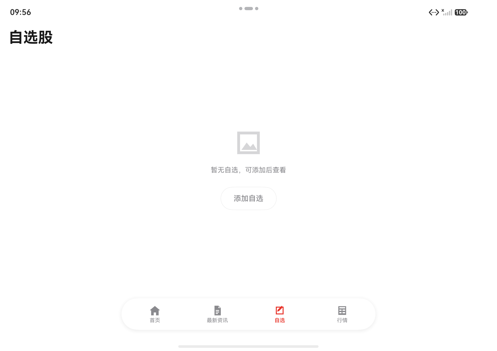
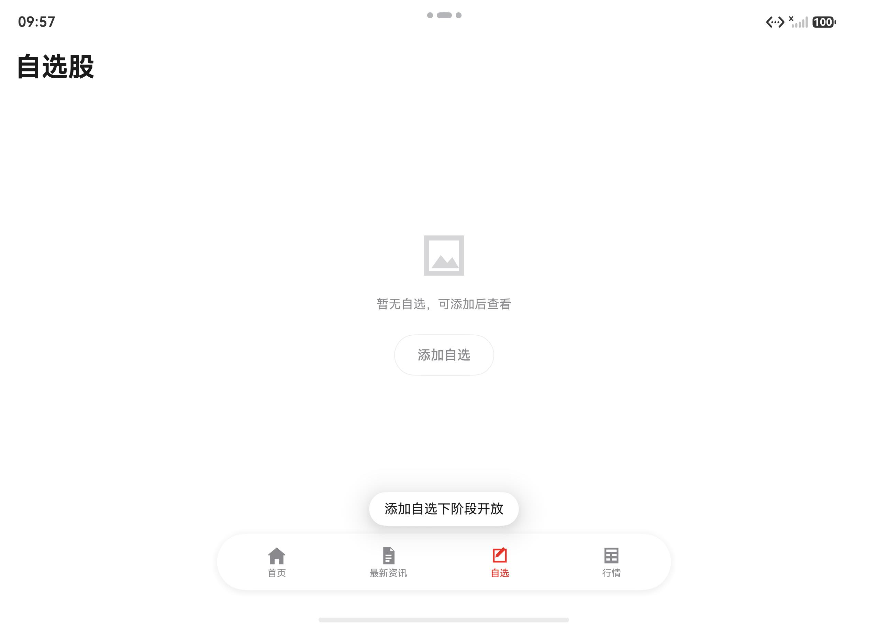
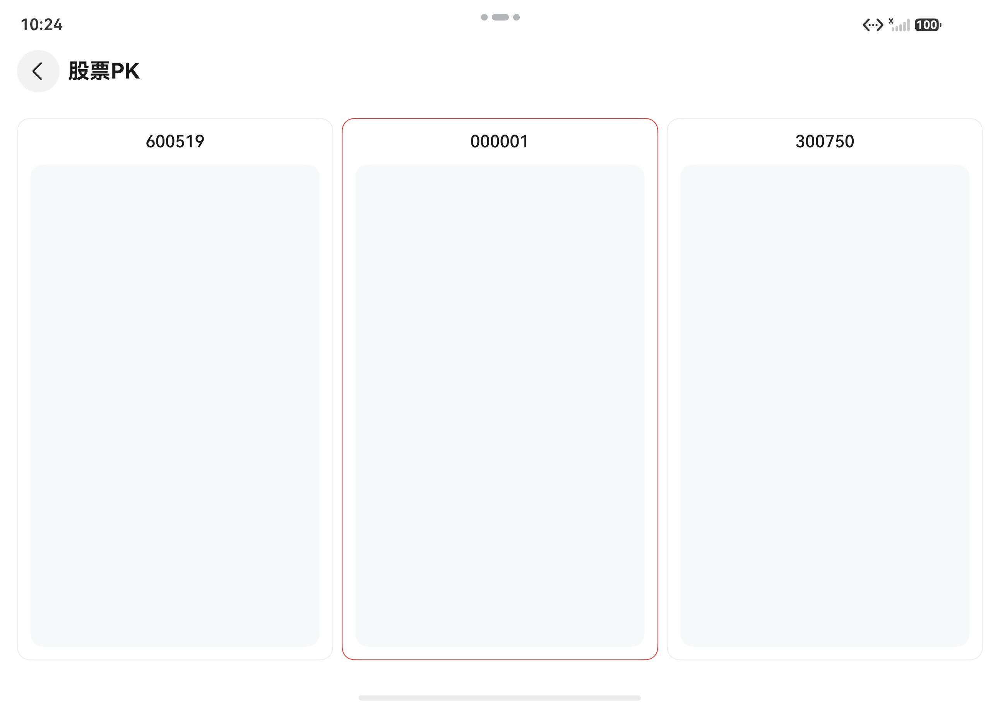
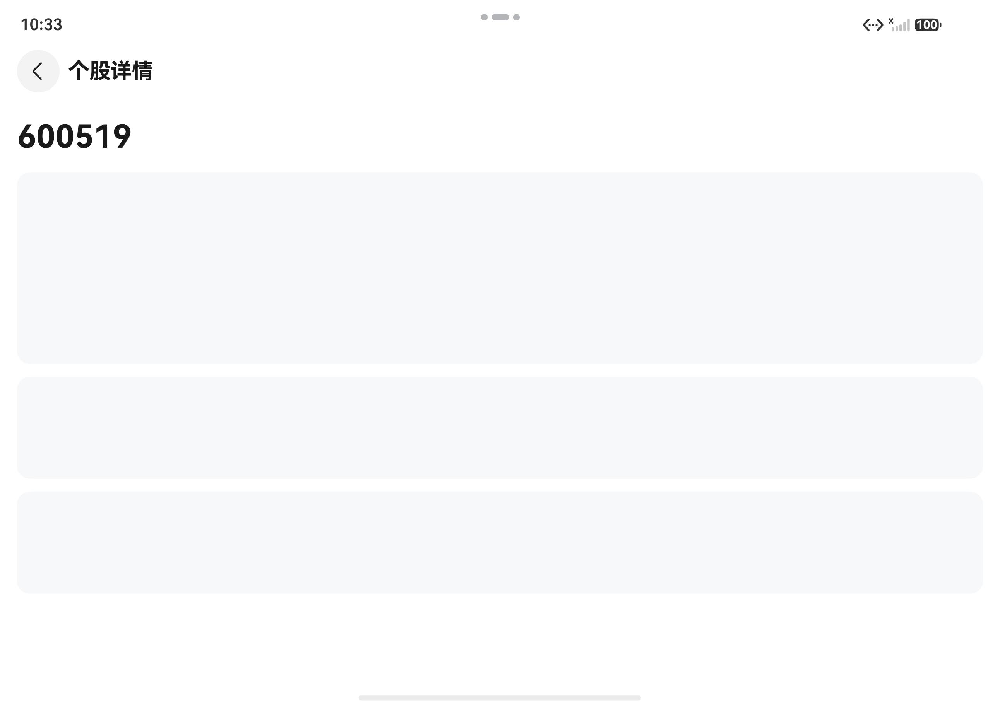
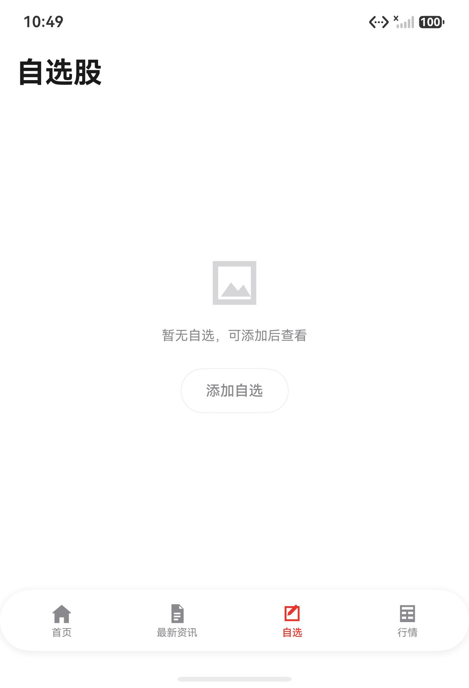
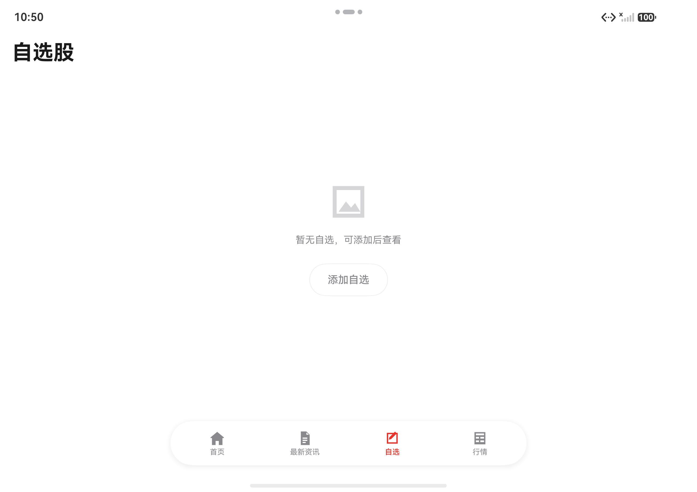
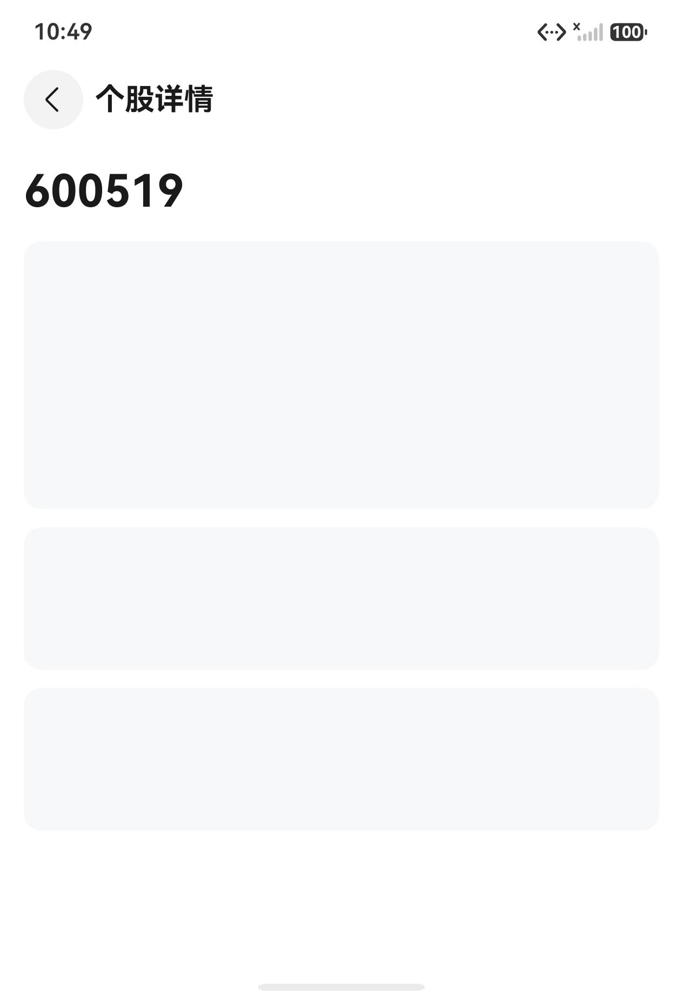
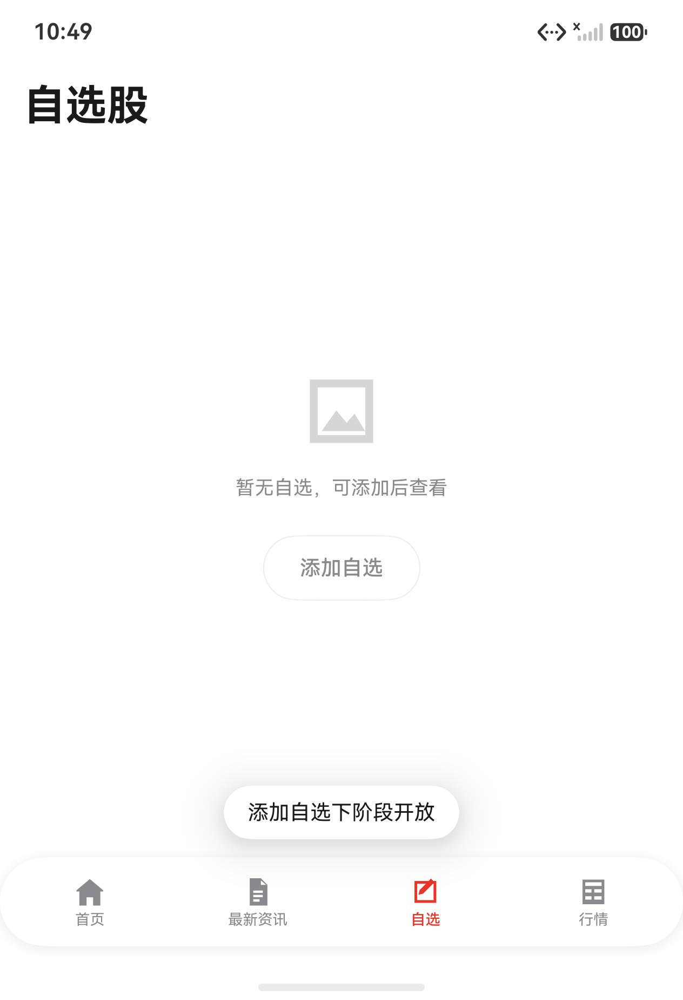

# 小杨股票 · 阶段一进度文档

> 版本：v0.4 · 更新：2026-11-11 · 当前里程碑：M0-3 完成（HEAD 以 `git log` 为准）
> 用途：**新会话的唯一上下文入口**。先读本文，再按任务检索设计文档，避免整读 115KB 设计说明书造成无效 Token。
> 边界：本文只记录「做到哪、下一步、怎么跑、坑在哪」；需求与设计口径以文末引用的文档为准，本文不重新定义 AC。

---

## 0. 新会话启动（60 秒）

1. 读完本文（约 5 分钟），不要先读设计文档全文。
2. 核对状态：`git log --oneline -5`、`git status --short`（应为干净）。
3. 确认基线可编译：`devecocli build`（见 §6，需提权）。
4. 按 §8 文档地图只读与本次任务相关的章节（设计文档用标题/关键词检索，不整读）。
5. 改动前先确认范围；完成后 build + lint +（涉及 UI 时）模拟器截图，再提交推送。

**一句话现状**：M0 外壳主链路已可用（8 模块、四 Tab、主题 token、ComingSoon、断点、路由目标页、深链、安全区/沉浸式）；**M0 还差占位文案单测/CI 红线、状态视图接线与 V0 补档**，之后进入 M1 自选列表。

---

## 1. 项目定位与阶段范围

- 产品：面向个人投资者的自选行情与交易工具（自选列表 → 个股详情 → 买入委托，折叠屏多窗比价）。
- 本仓库只做**阶段一**：真实行情/交易全部 Mock，三处入口（搜索/添加自选/卡片视图）只做占位。
- 明确不做：真实行情、真实交易网关、开户/KYC、委托列表与持仓、资讯内容、社区、研报、深色模式、横屏重排、多账户。

| 阶段 | 内容 | 状态 |
|---|---|---|
| V0 | 技术验证（11 列冻结横滑、图表库、折叠断点、V2+Navigation） | ✅ 已验证；报告文档待补（见 M0-6） |
| M0 | 外壳、路由栈、深链、沉浸式、主题 token、占位组件 | 🟡 主链路完成，收尾项见 §4 |
| M1 | 11 列冻结表、指数条、分组、排序、4 形态 | ⬜ 未开始 |
| M2 | 详情三形态、8 周期、图表、盘口、动作栏 | ⬜ 未开始 |
| M3 | 买入弹窗、校验、三态结果 | ⬜ 未开始 |
| M4 | 2/3 窗比价、换股、同步、降频 | ⬜ 未开始 |
| M5 | 断线、字号、无障碍、埋点、性能 | ⬜ 未开始 |

**技术基线（不可协商）**

| 项 | 取值 |
|---|---|
| SDK | `compileSdkVersion` / `targetSdkVersion` / `compatibleSdkVersion` = **20**（HarmonyOS 6.x） |
| 语言 | ArkTS 严格模式（禁 `any`/`unknown`、禁解构） |
| 状态管理 | **仅 V2**：`@ComponentV2` / `@ObservedV2` / `@Local` / `@Param` / `@Event` |
| 架构 | 官方三层：`products → features → commons` 单向依赖 |
| 路由 | 单 `EntryAbility` + `Navigation` / `NavPathStack`（不用全局 `router`） |
| 构建/包管理 | DevEco Studio + hvigor + ohpm（`devecocli` 封装） |
| 数据 | 三 Provider 全 Mock，契约与真实同形 |

---

## 2. 进度总览（M0-3 完成）

| 能力 | 状态 | 说明 |
|---|---|---|
| 8 模块三层骨架 | ✅ | 1 Entry HAP + 4 Feature HAR + 3 Common HAR，依赖显式声明 |
| 四 Tab 外壳 | ✅ | 首页 / 最新资讯 / 自选 / 行情，默认自选 |
| 自绘悬浮胶囊底栏 | ✅ | `Tabs(barHeight=0)` + `FloatingTabBar` |
| 三个占位 Tab | ✅ | `PlaceholderPage`，标题 + 说明 + 灰色图标位，无第二按钮 |
| 自选空态 | ✅ | `StateView` + 唯一「添加自选」入口（M1 替换为真实列表） |
| 占位文案统一 | ✅ | 5 条 i18n 字符串 + `ComingSoonText`，toast 1.8s |
| 主题 token | ✅ | 颜色/尺寸全部走 `commons/ui` 资源，组件无颜色字面量 |
| 断点工具 | ✅ | 600/840/1180、防抖、`AppStorageV2` 单例，折叠/展开实测 |
| Navigation 路由栈 | ✅ | `Navigation` + `AppServices.pathStack()` + AppRoot 单一 `pageMap` 分派 |
| 路由表（detail/pk/notFound） | ✅ | `AppRoutes` 参数契约、三个 `NavDestination` 壳、`pushDetail/pushPk/pushNotFound` 已实测 |
| 深链 | ✅ | scheme `zixuangu`、冷/热启动解析、缺参/非法→404、`detail:{code}` 300ms 去重 |
| 安全区 / 沉浸式 | ✅ | 全屏布局 + `SafeAreaService`（`avoidAreaChange`）；底栏 `inset+8`、页面预留 92vp |
| 占位文案单测、CI 红线 | ⬜ | 见 M0-4 |
| 状态视图三态接入 | 🟡 | 组件三态已写，当前只用了空态 |
| V0 验证报告 | ⬜ | `docs/v0-spike-report.md` 缺失，截图已有 |

最近提交：

```
4e7ab57 feat: 完成 M0-2 深链与 300ms 去重
091e88c feat: 完成 M0-1 路由目标页与分派
98c4dd4 docs: 新增阶段一进度文档
```

> M0-3 的代码提交紧随本文之后，最新 HEAD 以 `git log -1` 为准。

---

## 3. 已完成：M0 主链路

### 3.1 三层模块（当前真实结构）

| 模块 | 类型 | 路径（模块名） | 依赖 | 现状 |
|---|---|---|---|---|
| 产品定制层 | Entry HAP | `products/entry`（entry） | 4 feature + 3 common | 壳、路由栈、装配、设备形态 |
| 自选 | Feature HAR | `features/watchlist`（watchlist） | detail、commons_* | 空态页占位，M1 替换 |
| 详情 | Feature HAR | `features/detail`（detail） | trade、commons_* | 空壳（仅桶导出） |
| 交易 | Feature HAR | `features/trade`（trade） | commons_* | 空壳 |
| 多窗比价 | Feature HAR | `features/pk`（pk） | detail、commons_* | 空壳 |
| 设计系统 | Common HAR | `commons/ui`（commons_ui） | commons_basic | token、StateView、ComingSoon、Tab 图标 |
| 基础能力 | Common HAR | `commons/basic`（commons_basic） | — | 断点、常量、占位文案、i18n |
| 数据能力 | Common HAR | `commons/data`（commons_data） | commons_basic | 空壳（M1 起接契约/Mock） |

依赖白名单（新增横向依赖必须同步设计 §3.1.2 与 §3.1.10）：`watchlist → detail → trade`，`pk → detail`。

### 3.2 四 Tab 外壳

- [AppRoot（pages/Index.ets）](../products/entry/src/main/ets/pages/Index.ets)：`Navigation` 承载 `TabShell`，路由栈来自 `AppServices`。
- [TabShell.ets](../products/entry/src/main/ets/shell/TabShell.ets)：`Tabs` 只负责切页（`barHeight(0)`、禁用滑动），自选为 `index=2`。
- [FloatingTabBar.ets](../products/entry/src/main/ets/shell/FloatingTabBar.ets)：四等分、图标 + 文字、选中强调色；宽屏 `maxWidth=480`（`sm` 为 600）。
- [PlaceholderPage.ets](../products/entry/src/main/ets/shell/PlaceholderPage.ets)：首页/资讯/行情共用；[WatchlistPage.ets](../features/watchlist/src/main/ets/view/WatchlistPage.ets) 使用 `StateView` 空态。
- Tab 文案资源：`tab_home` / `tab_news` / `tab_watchlist` / `tab_market`。

### 3.3 主题 token

- 颜色：[color.json](../commons/ui/src/main/resources/base/element/color.json)；尺寸：[float.json](../commons/ui/src/main/resources/base/element/float.json)。
- 唯一入口：[TokenRegistry.ets](../commons/ui/src/main/ets/theme/TokenRegistry.ets)（`AppColor` / `AppDim`），组件内禁止颜色字面量。
- 关键 token：`color_bg_page`、`color_bg_surface`、`color_text_primary/secondary`、`color_price_up/down/flat`、`color_accent`、`color_divider`、`color_tag_fin/star`、`color_banner_bg`、`color_chart_line/avg`、`color_bar_shadow`、`color_transparent`。
- 尺寸：`row_height_base=56`、`header_height_base=40`、`touch_min=44`、`pill_radius=22`、`fade_width=20`、`gap_2/4/8/12/16/24`、`tab_bar_radius=30`。
- 本期只有 `base`；深色模式二期加 `resources/dark` 即可，组件零改动。

### 3.4 ComingSoon 与 StateView

- [ComingSoon.ets](../commons/ui/src/main/ets/components/ComingSoon.ets)：`showComingSoon(uiContext, text)`，toast 1.8s，失败只告警不阻塞入口。
- 文案唯一来源：[ComingSoonText.ets](../commons/basic/src/main/ets/constants/ComingSoonText.ets)，5 条完整字符串，禁止变体/拼接：

  | 常量 | 文案 |
  |---|---|
  | `ADD_WATCHLIST` | 添加自选下阶段开放 |
  | `CARD_VIEW` | 卡片视图下阶段开放 |
  | `HOME` | 首页下阶段开放 |
  | `NEWS` | 最新资讯下阶段开放 |
  | `MARKET` | 行情下阶段开放 |

- [StateView.ets](../commons/ui/src/main/ets/components/StateView.ets)：`LOADING / EMPTY / ERROR` 三态，图标位 + 说明 + 可选单一操作；空态不放置第二个按钮。

### 3.5 断点工具

- [BreakpointService.ets](../commons/basic/src/main/ets/services/BreakpointService.ets)：
  - `sm <600`、`md [600,840)`、`lg [840,1180)`、`xl ≥1180`（ADR-02，不用系统断点）。
  - `@Trace widthBp / viewportWidth / isSplit / listColumns / indexCount`；每个分支显式重置派生状态。
  - `BreakpointHost.init(mainWindow, uiContext)`：首值 + `windowSizeChange`（120ms 防抖）+ `UIContext.px2vp`；`detach()` 反注册。
  - 共享：`AppStorageV2.connect(..., 'breakpoint_service_v1', ...)`；组件用 `@Local` 持引用读 `@Trace`。
- 挂载点：[EntryAbility.ets](../products/entry/src/main/ets/entryability/EntryAbility.ets) 的 `loadContent` 回调；`onWindowStageDestroy` 反注册。
- 实测：展开 2584×1828px（≈957vp → lg），折叠 1264×1848px（≈468vp → sm），页面状态不丢、底栏宽度随断点变化。

### 3.6 工程清理

- 删除 V0 探针页（ChartProbe / V2Probe / prototype/）。
- 移除 entry 内 `@ohos/mpchart`；模板遗留 `float.json`、`dark/color.json` 已删。
- App 名称改为「小杨股票」；`deviceTypes` 为 `["phone","tablet"]`。
- 每模块根 `BuildProfile.ets` 由 hvigor 生成，已加入 `.gitignore`，不要提交。

---

### 3.7 路由目标页与分派（M0-1）

- 路由契约：[AppRoutes.ets](../products/entry/src/main/ets/router/AppRoutes.ets)：`RouteName.detail/pk/notFound`，`DetailParam { code, from, rank? }`、`PkParam { codes, focus? }`、`NotFoundParam { code? }`。
- 跳转入口：[AppServices.ets](../products/entry/src/main/ets/di/AppServices.ets)：`pushDetail / pushPk / pushNotFound / pop / backToTabs`，页面不直接操作路由栈。
- 统一分派：[Index.ets](../products/entry/src/main/ets/pages/Index.ets) 的单一 `@Builder pageMap`（`.navDestination` 只能挂一次）；目标页在 `onReady` 里用 `pathInfo.param` 取参。
- 目标页：
  - [DetailPage.ets](../products/entry/src/main/ets/pages/DetailPage.ets)：标题 + code + 骨架，M2 替换为 `QuoteHeader/ChartArea`。
  - [PkPage.ets](../products/entry/src/main/ets/pages/PkPage.ets)：2–3 窗骨架，`focus` 高亮，M4 替换为 `PkHost`。
  - [NotFoundPage.ets](../products/entry/src/main/ets/pages/NotFoundPage.ets)：404 态 + 唯一「返回自选」（`stack.clear()`）。
- 验证：detail 传 `600519` 进入/返回；pk 传三码 + `focus=1`；notFound 文案与返回根壳；截图见 `shots/m0-route-*.jpeg`。

### 3.8 深链（M0-2）

- 入口声明：[module.json5](../products/entry/src/main/module.json5) 的 `skills` 增加 `zixuangu` scheme（action `ohos.want.action.viewData` + entity `entity.system.browsable`）；不指定 Ability、仅用 `aa start -U` 也能由系统按 skills 唤起。
- 解析：[DeepLinkParser.ets](../products/entry/src/main/ets/router/DeepLinkParser.ets) 只认 host=`detail`；`code` 必须 6 位数字；支持 `from`（list/card/search/deeplink，默认 deeplink）与 `rank`；query 值先 `decodeURIComponent`，非法值回落默认。
- 生命周期：[EntryAbility.ets](../products/entry/src/main/ets/entryability/EntryAbility.ets) 的 `onCreate` / `onNewWant` → [DeepLinkHandler.ets](../products/entry/src/main/ets/router/DeepLinkHandler.ets)；冷启动写 [LaunchParam.ets](../products/entry/src/main/ets/router/LaunchParam.ets)，`Navigation.onAppear` 后消费一次；热启动直接 push。
- 去重：[NavigationGuard.ets](../products/entry/src/main/ets/router/NavigationGuard.ets) 在 `AppServices.pushDetail` 内按 `detail:{code}` 做 300ms 窗口。
- 失败：缺参 / 非法 code / 未知 host → `notFound`；`deeplink_invalid` 先以 hilog 记录（M5 接 Analytics）。
- 测试：`hdc shell aa start -U "zixuangu://detail?code=600519"`；冷启动前先 `aa force-stop`。
- 边界：未知/下架 code 的存在性校验依赖 M2 数据层；M0 只做格式与缺参校验。

### 3.9 安全区与沉浸式（M0-3）

- 服务：[SafeAreaService.ets](../commons/basic/src/main/ets/services/SafeAreaService.ets)，`@ObservedV2` + `AppStorageV2`，暴露 `top/bottom/left/rightInset`（vp）；读 `TYPE_SYSTEM` + `TYPE_NAVIGATION_INDICATOR` 的 `getWindowAvoidArea`，监听 `avoidAreaChange`，`EntryAbility.onWindowStageDestroy` 反注册。
- 全屏：[EntryAbility.ets](../products/entry/src/main/ets/entryability/EntryAbility.ets) 在 `loadContent` 回调里 `setWindowLayoutFullScreen(true)`，成功后 `SafeAreaHost.init`；失败降级为普通布局并初始化。
- 避让分配：
  - [Index.ets](../products/entry/src/main/ets/pages/Index.ets)：Navigation `.padding({ top: topInset })`，navBar 与所有 NavDestination 一起避让状态栏（Navigation 自身不会自动避让）。
  - [TabShell.ets](../products/entry/src/main/ets/shell/TabShell.ets)：Tabs `.padding({ bottom: bottomInset })`；[FloatingTabBar.ets](../products/entry/src/main/ets/shell/FloatingTabBar.ets)：`margin.bottom = bottomInset + 8`。
  - 页面预留 [LayoutConst.TAB_BAR_RESERVED = 92](../commons/basic/src/main/ets/constants/LayoutConst.ets)（底栏 60 + 间距 8 + 列表呼吸 24）。
  - [DetailPage.ets](../products/entry/src/main/ets/pages/DetailPage.ets) / [PkPage.ets](../products/entry/src/main/ets/pages/PkPage.ets)：内容 `padding.bottom = bottomInset + 16`。
- 实测（Pura X Max）：`top=39vp / bottom=28vp`；折叠 468vp 与展开 957vp 均无遮挡；详情标题栏位于状态栏下；toast 不被导航条遮挡。
- 说明：设计 §5.1.2 写 `expandSafeArea`；实际用官方「窗口全屏布局」方案，才能让底栏拿到 `avoidArea.bottom + 8` 的可测值（见 §10-11）。

---

## 4. M0 剩余任务（按已确认顺序）

> M0-3 已完成，剩余约 0.9 人日。**执行顺序：M0-4 门禁 → M0-5 状态视图 → M0-6 补档**，完成后再开 M1，避免在空路由上叠列表。

| ID | 任务 | 状态 | 依据 | 产出 / 验收 | 预估 |
|---|---|---|---|---|---|
| M0-1 | 路由目标页与注册 | ✅ | 设计 §3.5、§3.3、§5.1.1 | `AppRoutes` + 三个壳 + 单一 `pageMap`；push/pop 与参数已实测 | 0.3d |
| M0-2 | 深链 | ✅ | 设计 §3.5、§5.1 | `skills` + `DeepLinkParser/Handler` + `LaunchParam` + 300ms 去重；冷/热启动与 404 已实测 | 0.3d |
| M0-3 | 安全区与沉浸式 | ✅ | 设计 §5.1.2 | `SafeAreaService` + 全屏布局 + Navigation/Tabs/底栏避让；折叠/展开与详情实测 | 0.3d |
| M0-4 | 质量门禁 | ⬜ | 设计 §3.1.10、§6.3、§6.6 | 占位文案单测（5 条后缀/禁用词/版本号）、依赖红线 R-01~R-09 脚本、lint 进门禁 | 0.5d |
| M0-5 | 状态视图接线 | ⬜ | 设计 §5.1.5 | `StateView` 的 loading/error 在壳内可见；`Skeleton` 留到 M1；`GlobalBanner` 留到 M5（壳顶部预留挂点） | 0.2d |
| M0-6 | V0 报告补档 | ⬜ | 设计 §2.4、§9.4 | `docs/v0-spike-report.md`：设备型号/系统版本、冻结表帧率、图表库结论、V2+Navigation 结论；截图已在 `shots/v0-*` | 0.2d |

**下一步唯一优先项**：M0-4 质量门禁（占位文案单测 + 依赖红线 R-01~R-09 + lint 进门禁），门禁落地后 M1 才有护栏。

---

## 5. 工程地图（关键文件）

```
xiaoyang-stock/
├── AppScope/                         # 应用级配置与图标（bundle: com.example.xiaoyangstock）
├── products/entry/                   # Entry HAP
│   └── src/main/
│       ├── module.json5              # deviceTypes / pages / abilities / skills(待补深链)
│       ├── resources/                # 产品级图标、启动图、string/color
│       └── ets/
│           ├── entryability/EntryAbility.ets
│           ├── pages/Index.ets       # AppRoot：Navigation + TabShell + pageMap
│           ├── pages/{Home,News,Market}Page.ets
│           ├── pages/{Detail,Pk,NotFound}Page.ets
│           ├── shell/{TabShell,FloatingTabBar,PlaceholderPage}.ets
│           ├── router/AppRoutes.ets  # 路由名与参数契约
│           ├── router/{DeepLinkParser,DeepLinkHandler,LaunchParam,NavigationGuard}.ets
│           └── di/AppServices.ets    # 全局 NavPathStack + push 方法
├── features/
│   ├── watchlist/src/main/ets/view/WatchlistPage.ets
│   ├── detail/  trade/  pk/          # 仅 Index.ets 桶导出，M2/M3/M4 填充
├── commons/
│   ├── ui/src/main/ets/              # theme/TokenRegistry、components/{StateView,ComingSoon}
│   ├── ui/src/main/resources/        # color.json / float.json / ic_*.svg
│   └── basic/src/main/ets/           # services/{BreakpointService,SafeAreaService}、constants/{ComingSoonText,LayoutConst}
├── docs/                             # 设计说明书 + 本文
├── requirements/                     # 基线、横切规范、各 FR 子需求
├── design/                           # 16 张设计稿（直板/折叠/阔折叠/平板）
├── validation/                       # HTML 交互验证件 + 测试用例 md
└── shots/                            # V0/M0 验收截图
```

关键入口：

| 想看什么 | 看哪里 |
|---|---|
| 模块与依赖 | [build-profile.json5](../build-profile.json5)、各模块 `oh-package.json5` |
| 四 Tab 壳 | [TabShell.ets](../products/entry/src/main/ets/shell/TabShell.ets)、[FloatingTabBar.ets](../products/entry/src/main/ets/shell/FloatingTabBar.ets) |
| 路由栈/装配 | [AppServices.ets](../products/entry/src/main/ets/di/AppServices.ets)、[Index.ets](../products/entry/src/main/ets/pages/Index.ets) |
| 路由目标页 | [AppRoutes.ets](../products/entry/src/main/ets/router/AppRoutes.ets)、[DetailPage.ets](../products/entry/src/main/ets/pages/DetailPage.ets)、[PkPage.ets](../products/entry/src/main/ets/pages/PkPage.ets)、[NotFoundPage.ets](../products/entry/src/main/ets/pages/NotFoundPage.ets) |
| 深链 | [DeepLinkParser.ets](../products/entry/src/main/ets/router/DeepLinkParser.ets)、[DeepLinkHandler.ets](../products/entry/src/main/ets/router/DeepLinkHandler.ets)、[LaunchParam.ets](../products/entry/src/main/ets/router/LaunchParam.ets)、[NavigationGuard.ets](../products/entry/src/main/ets/router/NavigationGuard.ets) |
| 主题 | [TokenRegistry.ets](../commons/ui/src/main/ets/theme/TokenRegistry.ets) |
| 断点 | [BreakpointService.ets](../commons/basic/src/main/ets/services/BreakpointService.ets) |
| 安全区 | [SafeAreaService.ets](../commons/basic/src/main/ets/services/SafeAreaService.ets)、[EntryAbility.ets](../products/entry/src/main/ets/entryability/EntryAbility.ets)、[TabShell.ets](../products/entry/src/main/ets/shell/TabShell.ets) |
| 占位文案 | [ComingSoonText.ets](../commons/basic/src/main/ets/constants/ComingSoonText.ets) |

---

## 6. 环境与命令

| 项 | 值 |
|---|---|
| 工程根 | `D:\deepseek_harness_work\xiaoyang-stock` |
| 工具链 | DevEco Studio（内置 hvigor）+ 命令行工具；`devecocli 1.3.0-stable` |
| SDK | `D:\Huawei\HuaweiSDK\20`（API 20） |
| bundle | `com.example.xiaoyangstock` |
| 模拟器 | `Pura X Max`（widefold，`127.0.0.1:5557`）；另有实体 `HUAWEI Mate 60 Pro`，多设备时命令必须显式 `--device` |
| 构建产物 | `products/entry/build/default/outputs/default/entry-default-signed.hap` |
| 远端 | `https://github.com/AndGirl/AI-hmos-Stock.git`（main） |

```powershell
cd D:\deepseek_harness_work\xiaoyang-stock

devecocli build                 # 全量编译（含 ohpm install + hvigor sync）
devecocli run --device "Pura X Max"   # 构建 + 安装 + 启动（多设备必带 --device）
devecocli run --skip-build --device "Pura X Max"
devecocli check lint            # CodeLinter（当前 0 error / 5 warning）
devecocli ui screenshot --device "Pura X Max" --path .\shots\xxx.png
devecocli emulator fold close --target "Pura X Max"   # 折叠
devecocli emulator fold open  --target "Pura X Max"   # 展开
hdc -t 127.0.0.1:5557 shell "aa start -U 'zixuangu://detail?code=600519'"
hdc -t 127.0.0.1:5557 shell "aa force-stop com.example.xiaoyangstock"  # 测冷启动前
hdc list targets
```

**权限**：本会话文件策略为 workspace-write；`devecocli` / `git` / 设备命令需要 `danger-full-access` 提权，用户通常一次性授权。建目录/删文件若被沙箱拒绝，优先用写入工具或集中到同一条提权命令。

**依赖变更后**：先 `ohpm install --all`（或直接 build，devecocli 会自动跑），再编译；每个模块会更新自己的 `oh-package-lock.json5`。

---

## 7. 验证记录

| 验证 | 方式 | 结果 |
|---|---|---|
| 全量构建 | `devecocli build` | ✅ BUILD SUCCESSFUL（89 tasks），签名 HAP 约 293KB |
| 代码检查 | `devecocli check lint` | ✅ 0 error；5 条警告均为「页面级组件建议用 @Builder」的性能提示 |
| 四 Tab 切换 | Pura X Max 模拟器点击 | ✅ 首页/资讯/自选/行情均可切，默认自选 |
| 占位文案 | 布局树断言 | ✅ 首页/最新资讯/行情三页显示「…下阶段开放」 |
| ComingSoon | 点「添加自选」 | ✅ toast「添加自选下阶段开放」，1.8s |
| 断点/折叠 | 折叠 ↔ 展开 | ✅ 468vp→sm、957vp→lg，状态保持、底栏自适应 |
| 详情路由 | `pushDetail('600519','list')` | ✅ 标题/返回/code 正确，返回后回自选 |
| PK 路由 | `pushPk(['600519','000001','300750'],1)` | ✅ 三窗骨架、focus=1 高亮 |
| 404 路由 | `pushNotFound('999999')` + 返回自选 | ✅ 兜底文案与按钮，回根壳 |
| 深链冷启动 | force-stop 后 `aa start -U ...600519` | ✅ 直接进详情 |
| skills 唤起 | 不指定 ability，仅 `aa start -U` | ✅ 由 `zixuangu` scheme 拉起 |
| 深链热启动 | 已运行时 `aa start -U ...000001&from=search&rank=5` | ✅ onNewWant 生效，日志字段正确 |
| 深链缺参/非法/未知 host | `detail`、`code=12AB`、`quote` | ✅ 均落 404，`deeplink_invalid` 有日志 |
| 300ms 去重 | 同 tick 连续两次 `pushDetail` | ✅ 只入栈一次，返回一次即回 Tab |
| 全屏避让值 | SafeArea 日志 | ✅ `top=39vp / bottom=28vp` |
| 折叠/展开 | fold close/open | ✅ 468vp/957vp 无遮挡，标题始终在状态栏下 |
| 详情全屏 | 深链 `detail` | ✅ 返回键与标题不被状态栏遮挡 |
| toast 位置 | 点「添加自选」 | ✅ 位于底栏上方，不被导航条遮挡 |
| 依赖可解析 | build | ✅ 7 个 HAR 均参与编译，未声明依赖会构建失败 |

截图（仓库内）：













> 抓 1.8s toast 时，用 `hdc shell "uinput -T -c x y; snapshot_display -f /data/local/tmp/t.jpeg"` 再 `file recv`，避免 CLI 往返超时。

---

## 8. 文档地图（Token 友好读法）

| 文档 | 用途 | 建议读法 |
|---|---|---|
| [requirements/00-phase1-baseline.md](../requirements/00-phase1-baseline.md) | 阶段一范围、决策、裁决、AC 索引、验收矩阵、API 20 基线 | 全文 270 行，可整读；重点 §1/§2/§4/§8/§12 |
| [小杨股票PRD.md](../小杨股票PRD.md) | 产品口径、占位文案、页面状态矩阵、里程碑、风险 | 全文 320 行，可整读；重点 §3/§4/§5/§11 |
| [docs/phase1-technical-design.md](phase1-technical-design.md) | 技术架构与实现方案（2130 行） | **不要整读**；按 §8.1 索引检索 |
| [requirements/fr-common-spec.md](../requirements/fr-common-spec.md) | 横切规则 CC-1~CC-7（冲突时优先级最高） | 任务涉及全局规则时读 |
| [requirements/fr02…fr08-subreq.md](../requirements) | 各功能子需求与 AC | 只读当前模块 |
| [validation/](../validation) | HTML 交互验证件 + 测试用例 | 做 UI 对照时看 |
| [design/](../design) | 16 张设计稿（直板/折叠/阔折叠/平板） | 做视觉时按设备看对应图 |

**设计文档章节索引（按任务）**

| 任务 | 读这些节 |
|---|---|
| 分层/模块/依赖/装配 | §3.1（3.1.1~3.1.12）、§3.3、§3.4、§3.6 |
| 路由/深链 | §3.5、§5.1.1 |
| M0 外壳/安全区/token/占位/状态 | §5.1（5.1.1~5.1.5） |
| 断点 | §6.1 |
| 主题/i18n/占位校验 | §6.2、§6.3 |
| 工程红线/CI | §6.6、附录 C、§3.1.10 |
| M1 自选列表 | §5.2 全节 + 附录 A 常量 |
| M2 详情 | §5.3 全节 |
| M3 交易 | §5.4 全节 |
| M4 多窗 | §5.5 全节 |
| 数据契约/实体 | §4.1~§4.8 |
| 验收/性能 | §1.3、§7、§8 |

**检索技巧**：先 `Select-String -Path docs\phase1-technical-design.md -Pattern '^#### 5\.2'` 定界，再按 offset 读局部；不要一次读整文件。

---

## 9. 约束速查（红线）

1. **仅 V2**：`@ComponentV2` 内禁用 `@State/@Prop/@Link/@Watch`；`@Param` 只读，`@Event` 上行。
2. **单向依赖**：`products → features → commons`；features 横向只允许 `watchlist→detail→trade`、`pk→detail`。
3. **跨模块只走桶导出**：`import { X } from 'detail'`，禁止深路径（R-06）。
4. **颜色零字面量**：一律 `AppColor` / `$r('app.color.*')`；涨跌必须走 `price_up/down`。
5. **占位文案单一模板**：`{对象}下阶段开放`，5 条常量，禁止「敬请期待 / 即将上线 / Coming / ~ / !」、禁止版本号。
6. **11 列固定**，不按宽度减列；平板靠横滑（DEC-09-02）。
7. **断点阈值**：600 / 840 / 1180；`xl` 才 `isSplit`；指数条 3/5/5/3。
8. **底栏遮挡**：页面底部预留 92vp（底栏 60 + 间距 8 + 呼吸 24）；底栏距屏幕底 = `avoidArea.bottom + 8vp`。
9. **toast 1.8s**；占位入口图标不置灰。
10. **单 EntryAbility**；页面跳转走 `Navigation`，禁用全局 `router`；`new Mock*/Real*` 只允许在 `commons/data/DataServices.ets`（M1 起）。
11. **禁止页面自建轮询/重连定时器**（M5 的 `ConnectionHub` 统一）。
12. **深链** scheme `zixuangu`，示例 `zixuangu://detail?code=600519&from=deeplink`。

---

## 10. 已知偏差与待确认

| # | 项 | 现状 | 依据/处理 |
|---|---|---|---|
| 1 | `@ohos/mpchart` 依赖 | 已从 `commons/data` 暂时移除（M0 无图表，避免无用包与 HAR 资源重复告警） | M2 做 `ChartEngine` 适配层时按设计 §2.3 加回 `3.0.31` |
| 2 | 深色资源 | 只保留 `base`；entry 的模板 `dark/color.json`、`float.json` 已删 | 与设计 §6.2 一致；二期加 `dark` 目录即可 |
| 3 | toast 位置 | 系统默认底部居中（设计写「居中偏下」） | M0-3 做安全区时一并校准 |
| 4 | 底栏尺寸 | 高度 60vp、圆角 30、宽屏上限 480vp | 设计 token 未给底栏专属值，先落在 `LayoutConst`/`float.json` |
| 5 | `StateView` | 三态组件已写，但只接了空态；无 title 字段 | M1/M2 接入 loading/error 时再扩 |
| 6 | CI | 仓库无 `.github/workflows`，lint 仅手动执行 | M0-4 落红线脚本与门禁 |
| 7 | V0 报告 | `docs/v0-spike-report.md` 缺失 | M0-6 补档 |
| 8 | 版本号 | `versionName` 仍为 1.0.0 | 发版前统一 |
| 9 | 深链埋点 | 仅用 hilog 记录 `deeplink_open` / `deeplink_invalid` | M5 接 `Analytics` 后改为正式上报 |
| 10 | 深链未知 code | 只校验 6 位格式；未知/下架的存在性 404 依赖数据层 | M2 `DetailRepository` 返回未知后 `pushNotFound` |
| 11 | 沉浸式实现 | 采用窗口全屏 `setWindowLayoutFullScreen(true)` + `SafeAreaService` 手动避让，未用组件 `expandSafeArea` | 官方「窗口全屏布局」方案；底栏可实测 `avoidArea.bottom + 8`；Navigation padding 让详情标题栏一起避让，视觉与设计稿一致 |

---

## 11. 常见坑（已踩过）

1. **HAR 入口位置**：`oh-package.json5` 的 `main` 指向**模块根** `Index.ets`，不是 `src/main/ets/Index.ets`；否则报 `00304003 Invalid main file`。
2. **移动模块路径后增量缓存脏**：出现 `symbolMap.map` 路径错误或旧 `entry/build` 引用，执行 `devecocli build clean` 后重建。
3. **沙箱**：workspace-write 下用 PowerShell `New-Item` 建多级目录会被拒；优先用写入工具创建文件（自动建目录），删除/移动集中走一条提权命令。
4. **`BuildProfile.ets`** 是 hvigor 生成物，已在 `.gitignore`；不要手改或提交。
5. **TabContent** 不能脱离 `Tabs`；默认 TabBar 用 `barHeight(0)` 隐藏，自绘底栏叠加在 `Stack` 上。
6. **`.navDestination` 只能调一次**，多次链式会后者覆盖前者；在单一 builder 内 `if/else` 分派。
7. **`@Builder` 多参数不刷新**；需要刷新时用单对象参数或拆组件。
8. **toast 截图**：1.8s 很短，用 §7 的 hdc 连拍命令，不要用两次 CLI 往返。
9. **`$r` 可用于类静态常量**（`ComingSoonText`/`TokenRegistry` 已验证），但仅限 `.ets` 且资源存在。
10. **`AppStorageV2.connect` 在 EntryAbility 中可用**（已实测），组件侧用 `@Local` 持同一实例即可获得 `@Trace` 刷新。
11. **NavDestination 取参**：API 20 的 `pathInfo.param` 是 `unknown`，不能直接赋给 `Object`；先判 `!== undefined` 再 `as DetailParam`。
12. **多设备**：`devecocli run` 必须带 `--device`（当前有模拟器 Pura X Max + 实体 Mate 60 Pro），否则报 `Multiple devices found`。
13. **深链联调**：`aa start -U` 不带 `-a/-b` 也能验证 skills；冷启动前先 `aa force-stop`，热启动直接再发一次 URI。
14. **onNewWant**：只处理 `onCreate` 会导致应用已运行时收到深链无反应；冷/热两个入口都要接。
15. **全屏 + Navigation**：全屏后 Navigation 不会自动避让状态栏，NavDestination 标题栏会顶到状态栏；在 Navigation 上加 `.padding({ top: topInset })` 可同时避让 navBar 与所有目标页。
16. **全屏底部**：Tabs 与 NavDestination 内容都要手动避让；本项目 Tabs 吃 `bottomInset`，详情/比价内容 `bottomInset + 16`，底栏 `bottomInset + 8`。

---

## 12. 协作约定

- 每完成一个可验收步骤：`devecocli build` + `devecocli check lint` +（UI）模拟器截图 → 中文提交信息（`feat/fix/docs/chore`）→ 推送 `origin/main`。
- 需求/设计口径变更：先与产品确认，再改文档，再改代码（PRD §13）。
- 提权命令尽量合并为一条，减少审批次数；删除/移动文件前先核对绝对路径。
- 本文在**每个里程碑或重大结构变更后更新**；只写状态/路径/命令/坑，不复制设计细节，控制在 450 行以内。

---

## 13. 变更记录

| 版本 | 日期 | 变更 |
|---|---|---|
| v0.1 | 2026-11-11 | 初版：基于 HEAD `945618a`，记录 M0 主链路完成状态、剩余任务、工程地图、环境命令、验证与坑；确认 M0 剩余顺序为「路由页 → 深链 → 安全区 → 门禁」，保留 mpchart 暂移除（M2 加回）的偏差记录 |
| v0.2 | 2026-11-11 | M0-1 完成：新增 `AppRoutes` 参数契约、`DetailPage/PkPage/NotFoundPage` 三个 NavDestination 壳、`AppServices` push 方法、AppRoot 单一 `pageMap`；补详情/PK/404 验证截图与多设备、`pathInfo.param` 取参坑；下一步切到 M0-2 深链 |
| v0.3 | 2026-11-11 | M0-2 完成：`skills` scheme `zixuangu`、`DeepLinkParser/Handler/LaunchParam/NavigationGuard`、冷启动暂存与 `onNewWant` 热启动、缺参/非法/未知 host→404、300ms 去重；补深链验证截图与 hilog 埋点占位；下一步切到 M0-3 安全区 |
| v0.4 | 2026-11-11 | M0-3 完成：`SafeAreaService`（`avoidAreaChange` + AppStorageV2）、窗口全屏、Navigation 顶部避让、Tabs 底部避让、底栏 `inset+8`、页面预留 92vp；折叠/展开与详情/toast 实测；登记全屏方案与设计 `expandSafeArea` 的偏差；下一步 M0-4 门禁 |
